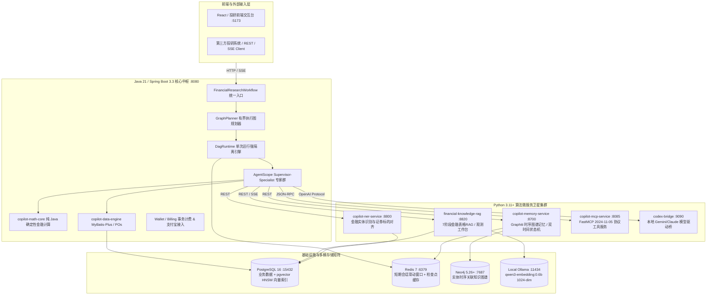

# FinancialCopilot (金融投研多智能体协同平台)

> **基于 Java 21 + Spring Boot 3.3.3 + AgentScope Java 2.x + MyBatis-Plus + PostgreSQL 16 (PGVector) + Neo4j + FastMCP 的工业级严肃金融智能投研平台**

[](https://www.oracle.com/java/)
[](https://spring.io/projects/spring-boot)
[](https://baomidou.com/)
[](https://github.com/pgvector/pgvector)
[](https://neo4j.com/)
[](https://fastapi.tiangolo.com/)
[](LICENSE)

---

## 📌 目录 (Table of Contents)

- [1. 平台定位与四大核心设计哲学](#1-平台定位与四大核心设计哲学)
- [2. 系统全景架构拓扑 (Overall Architecture)](#2-系统全景架构拓扑-overall-architecture)
- [3. Java 核心工程多模块架构规范](#3-java-核心工程多模块架构规范)
- [4. 核心引擎：动态有向无环图 (Dynamic DAG Execution Graph)](#4-核心引擎动态有向无环图-dynamic-dag-execution-graph)
- [5. 卫星微服务生态集群 (Satellite Python Microservices)](#5-卫星微服务生态集群-satellite-python-microservices)
- [6. 上下文工程与 Agent Skills 体系 (Context Engineering)](#6-上下文工程与-agent-skills-体系-context-engineering)
- [7. 用户隔离、商业化计费与支付宝接入 (Security & Billing)](#7-用户隔离商业化计费与支付宝接入-security--billing)
- [8. 环境准备与全链路快速启动 (Quick Start)](#8-环境准备与全链路快速启动-quick-start)
- [9. 核心 RESTful / SSE API 端点指南](#9-核心-restful--sse-api-端点指南)
- [10. 平台测试与验证矩阵 (Validation & Testing)](#10-平台测试与验证矩阵-validation--testing)

---

## 1. 平台定位与四大核心设计哲学

`FinancialCopilot` 旨在构建一个具备真实金融从业者严谨度的智能投研协同底座：
- **首期深度实施公募基金（Fund）领域**：涵盖基金标的、基金经理、基金管理公司三层拓扑网络；
- **原生通用扩展架构**：预留股票（Stock）、期货（Futures）、银行理财（Wealth Management）扩展插槽与策略分发；
- **解决复合长链路投研决策**：攻克单意图 Router 无法处理复合依赖链的痛点（如：*“筛选过去三年表现稳定的医药基金 $\to$ 分析前 5 名基金经理 $\to$ 对标最优 2 强 $\to$ 输出适格资产配置报告”*）。

```
┌─────────────────────────────────────────────────────────────────────────────────┐
│                           FinancialCopilot 四大核心设计哲学                      │
├───────────────────┬─────────────────────────────────────────────────────────────┤
│ 1. Tool-as-Truth  │ 严禁大模型心算！年化收益率、最大回撤、夏普比率、卡玛比率等指标一律由  │
│    (确定性计算)    │ 原生纯 Java 金融数学库 (copilot-math-core) 高精度计算，数值绝对真实 │
├───────────────────┼─────────────────────────────────────────────────────────────┤
│ 2. DAG 有界规划   │ 基于 GraphPlanner 的有向无环图规划与 DagRuntime 隔离运行，支持动态补数│
│    (有向执行图)    │ (GraphPatch)、显式依赖产物传递 (InputBinding) 与故障自愈恢复         │
├───────────────────┼─────────────────────────────────────────────────────────────┤
│ 3. 双轨时态与图谱  │ 拒绝纯向量 RAG 幻觉，引入 Graphiti 时序图谱记忆与 7 阶段金融表格保真 │
│    (时序可追溯)    │ RAG (表头挂顶/跨页缝合/断言级忠实度审计)，支持双时间时点回溯         │
├───────────────────┼─────────────────────────────────────────────────────────────┤
│ 4. 生产级合规与风控│ 严格的租户/用户数据隔离、Token 精确事务计费、支付宝 RSA2 官方支付体系 │
│    (严肃合规闭环)  │ 与脱敏工具审计 (Audit Log)，达到商业化金融软件交付标准                │
└───────────────────┴─────────────────────────────────────────────────────────────┘
```

---

## 2. 系统全景架构拓扑 (Overall Architecture)

平台采用 **“Java 严肃计算主干 + Python 专业算法卫星微服务 + 混合多模存储底座”** 的异构微服务拓扑：



### 微服务拓扑与端口对照表

| 服务组件 | 代码目录 | 默认端口 | 核心职责与关键能力 |
| :--- | :--- | :--- | :--- |
| **copilot-app** | `copilot-app` | `8080` | Spring Boot 核心调度、REST/SSE 端点、JWT 认证、商业化计费与支付宝集成 |
| **financial-knowledge-rag** | `financial-knowledge-rag` | `8820` | 7 阶段金融表格感知 RAG、跨页表格缝合、Cross-Encoder 神经重排与三合一前端观测台 |
| **copilot-memory-service** | `copilot-memory-service` | `8700` | Graphiti + Neo4j 时序知识图谱记忆、双时间状态机、半衰期衰减与记忆整理修剪 |
| **copilot-ner-service** | `copilot-ner-service` | `8800` | 金融命名实体识别（NER），6 位股票/基金代码与机构名称精准对齐 |
| **copilot-mcp-service** | `copilot-mcp-service` | `8085` | FastMCP 2024-11-05 协议兼容工具发现与动态执行微服务 |
| **codex-bridge** | `codex-bridge` | `9090` | 本地模型适配桥（桥接本地 `gemini-3.8-flash-low`，离线安全降级） |
| **PostgreSQL 16** | `docker/postgres` | `15432` | 业务时序数据、持仓穿透表与 pgvector 1024 维高密度 HNSW 向量索引 |
| **Neo4j** | `docker/postgres` | `7687/7474` | 实体关联图谱与 Graphiti Episode 时序时态记忆存储 |
| **Redis** | 本机 / 容器 | `6379` | 会话短期滑动窗口、分布式锁与 24 小时检查点（Checkpoint）缓存 |

---

## 3. Java 核心工程多模块架构规范

项目遵循严格的**整洁架构（Clean Architecture）与六边形依赖原则**，依赖关系单向由外向内收敛，业务核心无框架污染：

```
copilot-app (Spring Boot 装配 / 控制器 / SSE / 计费)
    │
    ▼
copilot-agent-core (动态 DAG 运行时 / GraphPlanner / Agent 编排)
    │
    ▼
copilot-agent-tools (AgentScope 工具实现 / 工具审计)
    │
    ▼
copilot-data-engine (MyBatis-Plus 适配器 / PGVector 访问 / POs)
    │
    ├─────────────────────────────┐
    ▼                             ▼
copilot-domain (领域模型/SPI端口)  copilot-math-core (纯Java金融确定性计算)
    │                             │
    └──────────────┬──────────────┘
                   ▼
copilot-common (通用 DTOs / 事件协议 / 枚举 / 结果体)
```

### 子模块核心清单

- **`copilot-common`**：全系统公用的通用值对象、枚举类（`AssetCategory`）、基础异常、统一返回体与响应式流式事件协议（`ResearchStreamEvent`）；
- **`copilot-domain`**：纯粹的业务领域层。定义业务模型、SPI 端口（`FundDataPort`、`AssetDomainStrategy`），绝对不依赖 Spring、MyBatis 或任何持久层/传输协议框架；
- **`copilot-math-core`**：**确定性纯 Java 金融计算核心库**。采用严密的 TDD 单测驱动开发，实现收益率、年化夏普比率（Sharpe）、最大回撤（Max Drawdown）、卡玛比率（Calmar）、索提诺比率（Sortino）、跟踪误差（Tracking Error）等计算；
- **`copilot-data-engine`**：持久层与存储适配器。采用 MyBatis-Plus 3.5.7 实现单表 CRUD 与 Lambda 强类型安全查询，集成 PostgreSQL 16 PGVector 向量计算（`<=>` 余弦距离操作符）；
- **`copilot-agent-tools`**：封装 AgentScope 声明式工具（`FundQuantAnalysisTool`、`FundHoldingsQueryTool`、`FundManagerProfileTool` 等），内置工具执行入参脱敏与审计埋点；
- **`copilot-agent-core`**：系统智能中枢。包含有向无环图规划器（`GraphPlanner`）、DAG 执行器（`DagRuntime`）、工件仓库（`ArtifactStore`）、输入绑定器（`InputBinding`）、动态补丁（`GraphPatch`）与统一投研工作流入口；
- **`copilot-app`**：Spring Boot 3.3.3 / WebFlux 应用入口。负责依赖注入装配、REST 控制器、SSE 流式管道、JWT 用户鉴权、商业化钱包账户与支付宝 SDK 支付集成。

---

## 4. 核心引擎：动态有向无环图 (Dynamic DAG Execution Graph)

面对复杂的金融投研意图，静态的线性 Chain 或死板的 StateMachine 无法满足动态依赖。`FinancialCopilot` 自研了工业级 **有界动态执行图系统**：

```
                    ┌────────────────────────────┐
                    │      用户复合投研指令      │
                    └─────────────┬──────────────┘
                                  │
                                  ▼
                    ┌────────────────────────────┐
                    │ GraphPlanner 有界规划引擎   │ ◄── 生成初始 ExecutionGraph
                    └─────────────┬──────────────┘
                                  │
                                  ▼
      ┌────────────────────────────────────────────────────────┐
      │ DagRuntime (单次运行隔离环境 runId)                    │
      │                                                        │
      │    ┌───────────────────────────┐                       │
      │    │    依赖就绪优先队列       │ ◄── 拓扑排序计算      │
      │    └─────────────┬─────────────┘                       │
      │                  │ 虚拟线程并发派发                    │
      │                  ▼                                     │
      │    ┌───────────────────────────┐                       │
      │    │  Agent 专家并发执行       │                       │
      │    │ (Fund / Quant / Manager)  │                       │
      │    └─────────────┬─────────────┘                       │
      │                  │                                     │
      │        ┌─────────┴─────────┐                           │
      │        ▼                   ▼                           │
      │  ┌───────────┐       ┌───────────┐                     │
      │  │ 产物写入  │       │ 动态补丁  │                     │
      │  │ Artifact  │       │ GraphPatch│ ──► 动态扩充拓扑图  │
      │  │ Store     │       └───────────┘     (补数/重试/跳过)│
      │  └─────┬─────┘                                         │
      │        │ 强类型显式提取                                │
      │        ▼                                               │
      │  ┌───────────┐                                         │
      │  │InputBinding│ ──► 解除下游节点依赖                   │
      │  └───────────┘                                         │
      └───────────────────────────┬────────────────────────────┘
                                  │
                                  ▼
                    ┌────────────────────────────┐
                    │ Checkpoint 持久化检查点    │ ◄── 支持 24h 暂停、取消与恢复
                    └─────────────┬──────────────┘
                                  │
                                  ▼
                    ┌────────────────────────────┐
                    │ SSE 响应式流式打字机事件流 │ ──► 毫秒级推送前端动态渲染
                    └────────────────────────────┘
```

### 核心设计特性：
1. **单一执行入口**：全系统无论是同步 REST、异步轮询还是 SSE 流式，统一由 `FinancialResearchWorkflow.run(GraphRunRequest)` 进入，彻底消除多头代码分叉；
2. **强类型数据流 (`InputBinding` & `ArtifactStore`)**：节点间数据传递禁止使用弱类型全局上下文，必须通过 `InputBinding` 明确声明消费上游哪个节点的输出产物，确保数据因果完全可溯源；
3. **动态拓扑自愈 (`GraphPatch`)**：当 Agent 在执行中发现数据缺失（例如初筛后发现某基金无三年历史业绩），可发起 `GraphPatch` 动态向图中追加“回退补数”或“替换标的”节点，无须推翻全图重跑；
4. **状态检查点与恢复 (`Checkpoint`)**：运行态状态每步落库，支持超长运行任务的安全中断、幂等恢复与超时自动清理；
5. **响应式事件协议 (`ResearchStreamEvent`)**：向前端输出 `graph_initialized`、`node_ready`、`node_started`、`content_chunk`、`graph_updated`、`node_completed`、`run_completed` 等规范事件。

---

## 5. 卫星微服务生态集群 (Satellite Python Microservices)

### 5.1 金融表格保真 RAG 微服务 (`financial-knowledge-rag` :8820)
- **攻克金融 PDF 提取痛点**：基于几何坐标过滤页眉（$y_0 < 60$）与页脚页码（$y_0 > 735$）；动态外接矩形遮罩消除文本重复；智能跨页缝合完整保留跨页报表；
- **强制表头挂顶 (Header Pinning)**：长表格切块时，每个衍生子切片顶部强制复制列名定义，杜绝数值与表头脱钩；
- **7 阶段白盒化流水线**：文档解析 ➔ 顺应大纲切块 ➔ 1024 维 Embedding ➔ 双路并发粗召回 ➔ RRF 倒数排名融合 ➔ Cross-Encoder 神经重排与业务加权 ➔ 生成与断言级事实忠实度双轨审计；
- **三合一前端观测台**：集成全流程耗时瀑布流、103 切片纯前端缓存质检台（<5ms 过滤与乐观更新）与多策略横向跑分评估中心。

### 5.2 时序知识图谱记忆微服务 (`copilot-memory-service` :8700)
- **Agentic Memory 三件套**：Ledger 只追加原始账本 + Views 多任务派生视图 + Policy 控制策略；
- **五层认知模型**：L0 会话元数据 ➔ L1 Redis 短期滑动窗口 ➔ L2 对话增量摘要 ➔ L3 结构化用户档案卡 ➔ L4 Graphiti 时序事实图谱；
- **双时间状态机 (Bi-Temporal)**：严格区分现实有效时间（`valid_at` ~ `invalid_at`）与系统记录时间（`recorded_at` ~ `superseded_at`），解决用户改口（保守变进取）的事实冲突并支持时点回溯（Time-Travel）；
- **指数半衰期多因子衰减模型**：$\text{FinalScore} = 0.5 \cdot S_{\text{semantic}} + 0.3 \cdot e^{-\lambda \Delta t} + 0.2 \cdot S_{\text{importance}}$（30 天半衰期）；
- **生命周期治理**：显式即刻落库、后台 Consolidation 去重合并与三维 Pruning 清理修剪（失效记忆、90 天未访问冷记忆、低重要性杂音）。

### 5.3 FastMCP 工具执行微服务 (`copilot-mcp-service` :8085)
- 基于 FastMCP 2024-11-05 协议构建，动态发布投研专用工具并支持独立热插拔运行。

### 5.4 本地模型驱动服务 (`codex-bridge` :9090)
- 遵循平台全局规范，优先使用本地 `codex-bridge` 作为 LLM 驱动，对外提供标准 OpenAI 兼容接口，统一桥接本地 `gemini-3.8-flash-low`，彻底避免硬编码官方远程 API Key。

---

## 6. 上下文工程与 Agent Skills 体系 (Context Engineering)

### 6.1 工业级 RTCF 提示词架构与 Context Caching 适配
系统提示词遵循 **Role-Task-Context-Format (RTCF)** 严格分槽设计：
- **Role (静态人设)**：保持头部前缀严格稳定，最大化命中模型厂商的 **Context Caching** 缓存加速与减费策略；
- **Task (目标指引)**：清晰单一的目标约束；
- **Context (事实槽位)**：按需装配清洗后的观察值、用户画像约束、历史有效事实；
- **Format (输出契约)**：强制要求结构化 Markdown 研报分级协议。

### 6.2 观察值净化与 Token 配额控制
- **`ObservationSanitizer`**：深度清洗工具返回的原始 JSON，剔除海量 `null`、无用技术元数据与冗余嵌套，转化为高信噪比事实，**降低 Token 消耗 50%~70%**，杜绝大模型在复杂嵌套括号中发生注意力涣散；
- **`ContextReducer` & `ContextBudgetManager`**：短期记忆超限时自动将早期对话提炼为滚动摘要置顶保留，结合配额管理器自适应截断。

### 6.3 声明式 Agent Skills 机制
- **`SKILL.md` 规范**：存放于 `classpath:skills/{skill_name}/SKILL.md`，使用 YAML 元数据标注任务类型、触发规则与行业细化准则；
- **按需动态装配**：`SkillMatcher` 仅在子任务类型或意图命中时动态挂载对应技能，未命中技能零 Token 占用；
- **首发投研技能库**：
  - `fund-comparison`：公募基金两强对标四步审计法（风险收益对称性、重仓风格漂移检验、言行一致性核验、市场风格适应性）；
  - `asset-allocation`：适格投资者 C1~C5 风险等级与核心-卫星仓位管理规范；
  - `quant-screening`：量化初筛硬性准入门槛与异常风控剔除准则。

---

## 7. 用户隔离、商业化计费与支付宝接入 (Security & Billing)

### 7.1 严格多租户与水平越权防护
- 所有会话、运行、订单与记忆接口强制绑定登录 JWT 中的 `userId`；
- 尝试访问非本人拥有的 `conversationId` 或 `runId` 统一返回 **HTTP 404 Not Found**（而非 403 Forbidden，杜绝通过状态码探测其他合法资源的元数据泄漏）。

### 7.2 Token 用量与商业化计费事务
- 计费严格统计大模型返回的实际 `usage` 与模型类型（覆盖规划、基金对比与报告合成）；
- 扣款与用量流水在**同一个数据库事务内**执行原子提交，余额不足立即阻断，杜绝产生账务坏账；
- 流式输出中若客户端意外断连，服务端会自动结算该步实际产生的 Token 用量，不再触发后续步骤。

### 7.3 支付宝官方 RSA2 公钥支付接入
集成支付宝官方 Java SDK 电脑网站支付能力：
1. 前端调用 `POST /api/v1/billing/order/create` 创建套餐订单；
2. 调用 `POST /api/v1/billing/alipay/order/{orderNo}/pay` 获取带防篡改签名的官方收银台跳转 URL；
3. 支付宝网关向公网异步通知地址 `POST /api/v1/billing/alipay/notify` 发送表单回调；
4. 服务端执行 RSA2 验签，校验应用 ID、商户号、订单号与金额一致性；
5. 采用**数据库行锁与已支付交易号唯一索引**，确保网络重试回调下绝对幂等（重复通知仅入账一次）。

---

## 8. 环境准备与全链路快速启动 (Quick Start)

### 8.1 基础设施依赖环境准备
- **Java**：JDK 21 LTS
- **Python**：Python 3.11+
- **构建工具**：Apache Maven 3.9+
- **容器环境**：Docker & Docker-Compose

### 8.2 启动数据库与图谱集群
进入 `docker/postgres/` 目录：
```powershell
cd docker/postgres
docker-compose up -d
```
> 将自动启动 PostgreSQL 16 (端口 `15432`)、Neo4j 5.26 (端口 `7687/7474`)，并执行初始 DDL 与 pgvector 扩展装配。

### 8.3 启动本地大模型驱动桥 (`codex-bridge`)
```powershell
cd codex-bridge
python -m uvicorn app.main:app --host 127.0.0.1 --port 9090
```
> 健康检查：`curl http://127.0.0.1:9090/health`

### 8.4 启动 Python 专业算法微服务
分别在独立终端启动卫星微服务：

```powershell
# 1. 记忆图谱微服务 (Port 8700)
cd copilot-memory-service
uvicorn app.main:app --host 127.0.0.1 --port 8700 --reload

# 2. 金融知识库 RAG 微服务 (Port 8820)
cd financial-knowledge-rag
uvicorn app.main:app --host 127.0.0.1 --port 8820 --reload

# 3. 实体识别 NER 微服务 (Port 8800)
cd copilot-ner-service
uvicorn app.main:app --host 127.0.0.1 --port 8800 --reload

# 4. FastMCP 微服务 (Port 8085)
cd copilot-mcp-service
python -m app.main
```

### 8.5 构建并启动 Java 主程序
在项目根目录下构建并启动：
```powershell
# 1. 运行编译与全量单测 (使用专有 maven-settings)
mvn -s maven-settings.xml clean test "-Dcopilot.neo4j.enabled=false"

# 2. 启动 Spring Boot 主应用
mvn spring-boot:run -pl copilot-app
```
> 主服务启动于：`http://localhost:8080`

---

## 9. 核心 RESTful / SSE API 端点指南

### 9.1 统一投研任务执行入口 (`POST /api/v1/research/runs`)

- **请求体格式**：
```json
{
  "prompt": "对比诺安成长2026年第1季度和第2季度的报告期末基金份额总额是多少？前三大重仓股票有何变动？",
  "conversationId": "3fa85f64-5717-4562-b3fc-2c963f66afa6",
  "enableThinking": false
}
```

- **同步响应模式 (`Accept: application/json`)**：
返回包含 `runId`、`conversationId`、最终合成研报、Graph 拓扑版本号、节点数及 Token 消耗统计的结构化结果。

- **流式打字机响应模式 (`Accept: text/event-stream`)**：
通过 Server-Sent Events (SSE) 协议实时输出动态执行图事件流：
```
event: graph_initialized
data: {"runId":"run_9a18f","graphVersion":1,"totalNodes":4}

event: node_started
data: {"nodeId":"node_quant_01","agentRole":"fund-analyzer"}

event: content_chunk
data: {"delta":"诺安成长混合型证券投资基金在2026年第1季度末总份额为..."}

event: run_completed
data: {"runId":"run_9a18f","totalDurationMs":3420}
```

### 9.2 运行控制与检查点管理

| 方法 | 请求路径 | 职责说明 |
| :--- | :--- | :--- |
| `GET` | `/api/v1/research/runs/{runId}` | 查询当前运行的实时状态、已就绪节点与检查点 |
| `POST` | `/api/v1/research/runs/{runId}/cancel` | 取消正在执行的 DAG 流程，释放占用并发信号量 |
| `POST` | `/api/v1/research/runs/{runId}/resume` | 从上一次保存的 Checkpoint 检查点幂等恢复执行 |
| `GET` | `/api/v1/research/runs/{runId}/tool-audits` | 调取该次投研执行过程中所有脱敏的工具调用审计明细 |

### 9.3 平台健康状况与能力清单 (`GET /api/v1/research/health`)
```json
{
  "code": 200,
  "message": "success",
  "data": {
    "status": "UP",
    "system": "Financial Research Agent (AgentScope + Spring Boot 3 + MyBatis-Plus)",
    "activeDomain": "FUND (公募基金深度实施)",
    "extensibleDomains": ["STOCK (股票)", "FUTURES (期货)", "WEALTH (银行理财)"],
    "pipelineCapabilities": ["SCREENING", "BATCH_ANALYSIS", "COMPARISON", "SYNTHESIS", "COMPOSITE_DAG"],
    "orm": "Lombok + MyBatis-Plus 3.5.7 + PGVector"
  }
}
```

---

## 10. 平台测试与验证矩阵 (Validation & Testing)

项目构建了金字塔式的严密自动化测试防护网：

```powershell
# 1. 窄范围核心单测 (无需启动外部 Neo4j)
mvn -s maven-settings.xml -pl copilot-math-core test
mvn -s maven-settings.xml -pl copilot-agent-core test
mvn -s maven-settings.xml test "-Dcopilot.neo4j.enabled=false"

# 2. 离线快速编译 (依赖已就绪时)
mvn -s maven-settings.xml test -o "-Dcopilot.neo4j.enabled=false"

# 3. 包含 PostgreSQL 与 Redis 的端到端全量集成测试
mvn -s maven-settings.xml test "-Dcopilot.integration=true"

# 4. 记忆系统 Python 微服务单测 (11 项全部通过)
cd copilot-memory-service
python -m pytest tests/unit/ -v

# 5. 金融 RAG 微服务契约与工作台单测
cd financial-knowledge-rag
python -m pytest tests/unit/test_frontend_workbench.py -v
```

### 关键配置开关组合一览

| 配置项 | 环境变量 | 默认值 | 作用说明 |
| :--- | :--- | :--- | :--- |
| `copilot.neo4j.enabled` | `NEO4J_ENABLED` | `true` | 为 `false` 时关闭 Neo4j 依赖，跳过真实图谱查询降级为基础持仓查询 |
| `copilot.redis.enabled` | `REDIS_ENABLED` | `true` | 为 `false` 时使用本地内存有界缓存（上限 1000 键，30min TTL）替代 Redis |
| `copilot.conversation.persistence-enabled` | `CONVERSATION_PERSISTENCE_ENABLED` | `true` | 为 `false` 时关闭会话落库，仅保留纯内存交互 |
| `copilot.alipay.enabled` | `ALIPAY_ENABLED` | `false` | 支付宝电脑网站支付开关，默认处于沙箱关闭模式 |

---

## 📄 许可证 (License)

本项目采用 [Apache License 2.0](LICENSE) 协议开源。
