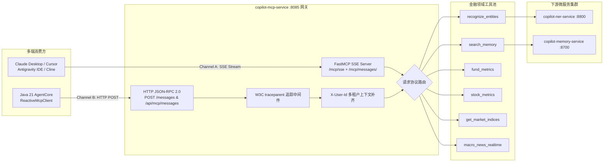

# FinancialCopilot FastMCP Service (`copilot-mcp-service`)

> **基于 Model Context Protocol (MCP 2024-11-05) 官方规范构建的 Python FastMCP 金融投研专业工具发现与执行网关**  
> 默认监听端口：`8085` | 核心引擎：Python 3.11+ / FastMCP (`mcp[cli]>=1.3.0`) / FastAPI / Uvicorn

[](https://modelcontextprotocol.io/)
[](https://www.python.org/)
[](https://fastapi.tiangolo.com/)
[](LICENSE)

---

## 📌 目录 (Table of Contents)

- [1. 服务定位与核心价值](#1-服务定位与核心价值)
- [2. 双通道通信架构与技术拓扑](#2-双通道通信架构与技术拓扑)
- [3. 全量发布金融专业工具清单 (Tools Catalog)](#3-全量发布金融专业工具清单-tools-catalog)
- [4. 全链路追踪与多租户安全上下文透传](#4-全链路追踪与多租户安全上下文透传)
- [5. 客户端接入与原生挂载指南](#5-客户端接入与原生挂载指南)
  - [5.1 接入方式一：Java Spring Boot (ReactiveMcpClient) 极速调用](#51-接入方式一java-spring-boot-reactivemcpclient-极速调用)
  - [5.2 接入方式二：Claude Desktop 原生挂载](#52-接入方式二claude-desktop-原生挂载)
  - [5.3 接入方式三：Antigravity IDE / Cursor / Cline 挂载](#53-接入方式三antigravity-ide--cursor--cline-挂载)
- [6. 配置说明与环境变量](#6-配置说明与环境变量)
- [7. 快速启动指南 (Quick Start)](#7-快速启动指南-quick-start)
- [8. 自动化测试与接口自检验证](#8-自动化测试与接口自检验证)

---

## 1. 服务定位与核心价值

在金融投研多智能体系统（Multi-Agent System）演进中，大语言模型（LLM）擅长逻辑编排与文本合成，但在以下三个维度存在天然短板：
1. **严禁心算金融指标 (Tool-as-Truth)**：夏普比率、最大回撤、市盈率 PE/PB 等数值，必须由权威确定性算法或真实时序数据源产出，严禁大模型通过上下文胡乱“脑补”；
2. **多语言生态解耦**：上层 Agent 调度主干使用 Java 21 (AgentScope / Spring Boot)，而底层实体抽取 (NER)、图谱检索、网络爬虫等数据源广泛使用 Python 生态，需要轻量高效的行业级跨语言开放协议；
3. **多 IDE / Agent 客户端通用挂载**：投研分析师既可能在 Java 投研工作台提问，也可能在 Claude Desktop、Cursor、Antigravity IDE 等独立客户端直接交互。

`copilot-mcp-service` 作为标准的 **Model Context Protocol (MCP)** 服务网关，严格遵循 Anthropic 主导的 **MCP 2024-11-05 协议标准**，实现金融工具的“一处编写、跨语言发现、全端挂载”。

---

## 2. 双通道通信架构与技术拓扑

服务采用 **“FastMCP 原生协议 + 极速 HTTP JSON-RPC 2.0 兼容端点”** 双通道混合驱动架构：



### 通道特性比对

| 通道名称 | 访问路径 | 交互协议 | 适用客户端 | 核心技术优势 |
| :--- | :--- | :--- | :--- | :--- |
| **通道 A：标准 MCP SSE 通道** | `GET /mcp/sse`<br>`POST /mcp/messages/` | SSE (Server-Sent Events) + JSON-RPC | Claude Desktop、Cursor、Antigravity IDE、Cline | 原生兼容 Anthropic 官方 SDK，支持双向心跳与流式事件订阅 |
| **通道 B：极速 HTTP 端点** | `POST /messages`<br>`POST /api/mcp/messages` | HTTP POST (纯 JSON-RPC 2.0 请求响应) | Java Spring Boot WebFlux (`ReactiveMcpClient`) | 避免维护长连接，适配微服务集群高并发负载均衡，压测吞吐量更高 |

---

## 3. 全量发布金融专业工具清单 (Tools Catalog)

目前网关稳定发布 6 项投研专业工具，全部通过 `@mcp.tool` 注册并输出标准 JSON Schema：

| 工具名称 (`name`) | 输入参数 (`arguments`) | 职责说明与业务语义 | 数据源与下游依赖 |
| :--- | :--- | :--- | :--- |
| `recognize_entities` | `text: str` | 对输入投研文本进行实体识别，抽取基金代码、基金名称、基金经理、股票等实体 | 远程调用 `copilot-ner-service:8800`，内置网络异常优雅降级 |
| `search_memory` | `query: str`<br>`user_id: Optional[str]`<br>`max_results: int = 5` | 按用户作用域检索长期记忆事实（如投资风格偏好、负向禁令、历史调仓事实） | 远程调用 `copilot-memory-service:8700`，带专属安全 Token 校验 |
| `fund_metrics` | `fund_code: str` (如 `005827`) | 查询公募基金核心量化绩效（3年年化收益率、最大回撤、夏普比率、卡玛比率） | 权威量化指标引擎（严防大模型心算幻觉） |
| `stock_metrics` | `stock_code: str` (如 `600519`) | 查询 A 股个股基本行情与核心财务指标（PE-TTM、市净率 PB、净资产收益率 ROE、股息率） | A 股上市公司财务报表与行情指标引擎 |
| `get_market_indices` | *无入参* | 获取中国核心宽基指数最新行情（上证指数、沪深300、创业板指点位与涨跌幅） | 实时行情看板快照 |
| `macro_news_realtime`| `keyword: str`<br>`limit: int = 5` | 检索最新宏观财经新闻、货币政策动向与行业资讯快讯 | 权威财经新闻专线快讯源 |

---

## 4. 全链路追踪与多租户安全上下文透传

为了支撑企业级微服务链路治理与多租户数据隔离，`copilot-mcp-service` 实现了透明上下文穿透：

```
Java Spring Boot (WebFlux)
  │  Headers:
  │    traceparent: 00-4bf92f3577b34da6a3ce929d0e0e4736-00f067aa0ba902b7-01
  │    X-User-Id: trader_888
  ▼
FastMCP Trace Middleware (:8085)
  ├─ 1. 自动提取 traceparent 并注入日志上下文，同时在响应头回写，实现 Langfuse / OpenTelemetry 链路串联
  ├─ 2. 自动提取 X-User-Id，若 tools/call 参数中缺失 user_id，自动补齐 arguments["user_id"] = "trader_888"
  ▼
下游微服务 (copilot-memory-service / copilot-ner-service)
```

- **容错防雪崩 (Fault Tolerance)**：
  当依赖的下游微服务（如记忆服务或 NER 服务）发生网络超时或宕机时，工具实现捕获内部异常并返回规范的 `{"status": "FALLBACK", "message": "Service unreachable", "results": []}` 结构，保证上层 Agent 收到结构化结果，绝不因下游单点异常导致主调用流程抛出 HTTP 500 崩溃。

---

## 5. 客户端接入与原生挂载指南

### 5.1 接入方式一：Java Spring Boot (ReactiveMcpClient) 极速调用

Java 后端通过 WebClient 异步向 `/messages` 或 `/api/mcp/messages` 发起 JSON-RPC 2.0 请求：

#### 1. 动态工具清单发现 (`tools/list`)
- **请求格式**：
```json
{
  "jsonrpc": "2.0",
  "id": "req-001",
  "method": "tools/list"
}
```
- **响应示例**：
```json
{
  "jsonrpc": "2.0",
  "id": "req-001",
  "result": {
    "tools": [
      {
        "name": "fund_metrics",
        "description": "查询公募基金核心量化绩效指标（年化收益、最大回撤、夏普比率、卡玛比率）",
        "inputSchema": {
          "type": "object",
          "properties": {
            "fund_code": {"type": "string", "title": "Fund Code"}
          },
          "required": ["fund_code"]
        }
      }
    ]
  }
}
```

#### 2. 工具执行调用 (`tools/call`)
- **请求格式**：
```json
{
  "jsonrpc": "2.0",
  "id": "req-002",
  "method": "tools/call",
  "params": {
    "name": "fund_metrics",
    "arguments": {
      "fund_code": "005827"
    }
  }
}
```
- **响应示例**：
```json
{
  "jsonrpc": "2.0",
  "id": "req-002",
  "result": {
    "content": [
      {
        "type": "text",
        "text": "{\"fund_code\": \"005827\", \"annualized_return_3y\": 0.128, \"max_drawdown_3y\": -0.185, \"sharpe_ratio_3y\": 1.45, \"calmar_ratio_3y\": 0.69, \"data_source\": \"copilot-fastmcp-engine\"}"
      }
    ],
    "isError": false
  }
}
```

---

### 5.2 接入方式二：Claude Desktop 原生挂载

在 Claude Desktop 的配置文件中挂载本服务（Windows 路径：%APPDATA%\Claude\claude_desktop_config.json；macOS 路径：~/Library/Application Support/Claude/claude_desktop_config.json）：

```json
{
  "mcpServers": {
    "financial-copilot-tools": {
      "url": "http://127.0.0.1:8085/mcp/sse"
    }
  }
}
```
> 配置完成后重启 Claude Desktop，界面右下角的小锤子图标中将自动点亮 `recognize_entities`、`fund_metrics` 等全部金融工具。

---

### 5.3 接入方式三：Antigravity IDE / Cursor / Cline 挂载

在开发环境的 `mcp_config.json` 或扩展配置中挂载：

```json
{
  "mcpServers": {
    "financial-copilot": {
      "url": "http://127.0.0.1:8085/mcp/sse",
      "transport": "sse"
    }
  }
}
```

---

## 6. 配置说明与环境变量

通过项目根目录下的 `.env` 文件或系统环境变量进行微服务通信配置：

| 变量名 | 默认值 | 作用说明 |
| :--- | :--- | :--- |
| `HOST` | `127.0.0.1` | 服务监听 IP 地址（生产容器部署可设为 `0.0.0.0`） |
| `PORT` | `8085` | 服务监听端口 |
| `SERVER_NAME` | `financial-copilot-tools` | MCP 注册中心服务名称 |
| `SERVER_VERSION` | `1.0.0` | MCP 协议版本号 |
| `NER_SERVICE_URL` | `http://127.0.0.1:8800` | 下游实体识别服务 (copilot-ner-service) 端点 |
| `MEMORY_SERVICE_URL` | `http://127.0.0.1:8700` | 下游记忆图谱服务 (copilot-memory-service) 端点 |
| `COPILOT_SERVICE_TOKEN`| `test-token` | 跨微服务内部调用专用安全鉴权 Token |
| `REQUEST_TIMEOUT` | `15.0` | 请求下游微服务 HTTP 连接/读取超时时间（秒） |

---

## 7. 快速启动指南 (Quick Start)

### 7.1 本地开发环境准备与启动
```powershell
# 1. 进入服务目录
cd copilot-mcp-service

# 2. 安装当前项目及其依赖
pip install -e .

# 3. 启动 FastAPI + FastMCP 服务
python -m uvicorn app.server:app --host 127.0.0.1 --port 8085 --reload
```

### 7.2 服务健康检查
启动后访问健康检查端点验证：
```powershell
curl http://127.0.0.1:8085/health
```
**预期输出**：
```json
{
  "status": "UP",
  "service": "financial-copilot-tools",
  "tools_count": 6,
  "protocol": "MCP 2024-11-05"
}
```

---

## 8. 自动化测试与接口自检验证

服务配有完备的自动化单测套件，覆盖健康检查、JSON-RPC 工具发现、工具执行、Ping 探活与未知方法异常阻断：

### 8.1 运行自动化测试
```powershell
python -m pytest tests/ -v
```
> **预期结果**：全部通过（`6 passed in 2.7s`）。

### 8.2 命令行 curl 自检工具调用
在命令行直接模拟 Java 后端发起基金指标查询：
```powershell
curl -X POST "http://127.0.0.1:8085/messages" `
  -H "Content-Type: application/json" `
  -H "X-User-Id: analyst_01" `
  -d '{
    "jsonrpc": "2.0",
    "id": "test-1",
    "method": "tools/call",
    "params": {
      "name": "fund_metrics",
      "arguments": {
        "fund_code": "005827"
      }
    }
  }'
```
**输出**：成功返回易方达蓝筹精选的 3 年年化收益率、最大回撤、夏普比率与卡玛比率确定性数据。
