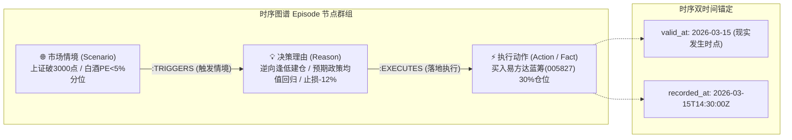
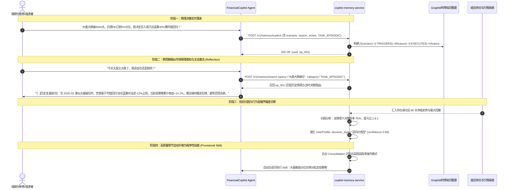
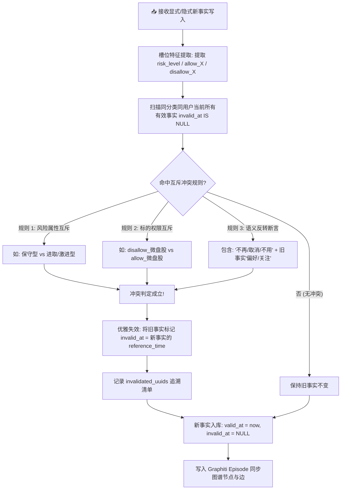

# FinancialCopilot 记忆系统 (`copilot-memory-service`)

> **面向金融投研多智能体 (Multi-Agent) 的时序知识图谱与分层认知记忆服务**  
> 默认监听端口：`8700` | 核心引擎：Python 3.11+ / FastAPI / Redis / Graphiti + Neo4j / Ollama (Qwen3-Embedding) / Codex-Bridge (`:9090`)

---

## 目录 (Table of Contents)

- [1. 为什么大模型 Agent 需要专业记忆系统？（核心背景与痛点）](#1-为什么大模型-agent-需要专业记忆系统核心背景与痛点)
- [2. 记忆系统整体架构与技术拓扑](#2-记忆系统整体架构与技术拓扑)
- [3. 架构基石：Agentic Memory 三件套设计](#3-架构基石agentic-memory-三件套设计)
- [4. 五层渐进式记忆分层模型 (L0 ~ L4)](#4-五层渐进式记忆分层模型-l0--l4)
- [5. 金融场景记忆四分类治理体系 (Taxonomy Matrix)](#5-金融场景记忆四分类治理体系-taxonomy-matrix)
- [6. 🎯 核心专题：情境决策情节记忆 (场景 Scenario ➔ 决策理由 Reason ➔ 执行动作 Action 三元组闭环)](#6--核心专题情境决策情节记忆-场景-scenario--决策理由-reason--执行动作-action-三元组闭环)
- [7. 双时间状态机与事实冲突失效机制 (Bi-Temporal & Conflict Resolution)](#7-双时间状态机与事实冲突失效机制-bi-temporal--conflict-resolution)
- [8. 多因子检索重排与时间半衰期衰减模型 (Multi-Factor Scoring & Decay)](#8-多因子检索重排与时间半衰期衰减模型-multi-factor-scoring--decay)
- [9. 记忆生命周期：显式落库、定期整理与清理遗忘 (Consolidation & Pruning)](#9-记忆生命周期显式落库定期整理与清理遗忘-consolidation--pruning)
- [10. 进阶演进：程序性记忆与 Skill 资产沉淀 (Procedural Memory)](#10-进阶演进程序性记忆与-skill-资产沉淀-procedural-memory)
- [11. 多租户与命名空间严格安全隔离](#11-多租户与命名空间严格安全隔离)
- [12. 核心 RESTful API 契约与使用范例](#12-核心-restful-api-契约与使用范例)
- [13. 🌟 面试高频深度考察 11 问与标准满分话术 (Interview Cheatsheet)](#13--面试高频深度考察-11-问与标准满分话术-interview-cheatsheet)
- [14. 快速启动与验证测试](#14-快速启动与验证测试)

---

## 1. 为什么大模型 Agent 需要专业记忆系统？（核心背景与痛点）

在构建专业级金融投研 Agent（如 `FundAnalyzerAgent`, `StockAnalyzerAgent`）时，**绝大多数团队早期会误以为“向量数据库 RAG = 记忆系统”**。然而在投研高频交互、风险偏好推断与合规决策落地中，纯向量 RAG 存在致命的体系缺陷：

### 传统纯向量 RAG 做记忆的五大硬伤

```
┌────────────────────────────────────────────────────────────────────────┐
│                    传统向量 RAG 用于记忆的典型失效案例                  │
├───────────────────┬────────────────────────────────────────────────────┤
│ 1. 精确标识匹配失效 │ 问“600519持仓”或手机号/订单号，向量召回噪声极大，      │
│                   │ 无法做到结构化精确查询 (Exact Match 100% 命中)     │
├───────────────────┼────────────────────────────────────────────────────┤
│ 2. 时间盲区与状态冲突 │ 用户半年前说“我住广州/保守型”，昨天改口“搬到上海/进取”，│
│                   │ 向量检索因语义高度相似同时召回新旧，造成模型严重精神分裂│
├───────────────────┼────────────────────────────────────────────────────┤
│ 3. 生命周期无差别对待 │ 把“今天大盘跌了”和“用户永远不要买ST股票”同权存入，       │
│                   │ 临时上下文与长期原则混杂，Token 膨胀失控            │
├───────────────────┼────────────────────────────────────────────────────┤
│ 4. 删除语义模糊不清 │ 用户要求“清空对话”、“撤回错误事实”与“GDPR 隐私物理抹除”，│
│                   │ 传统向量库仅能全删或暴力覆盖，破坏历史审计链条          │
├───────────────────┼────────────────────────────────────────────────────┤
│ 5. 缺乏因果情境沉淀 │ 仅记录断章文本，丢失了当时决策的触发情境 (Scenario) 与     │
│                   │ 逻辑动因 (Reason)，无法复盘投资心理                   │
└───────────────────┴────────────────────────────────────────────────────┘
```

为了彻底解决上述问题，`copilot-memory-service` 采用 **“只追加原始账本 (Ledger) + 多任务派生视图 (Views) + 策略引擎 (Policy)”** 架构，将记忆解耦为**短期会话缓冲、近期对话摘要、结构化用户档案、时序知识图谱与程序性技能**。

---

## 2. 记忆系统整体架构与技术拓扑

```
┌─────────────────────────────────────────────────────────────────────────────────┐
│              Java 21 / Spring Boot 3.3 后端 (AgentCore / Workflow)              │
│       (FundAnalyzerAgent / ReportSynthesizerAgent / ContextualToolkit)          │
└──────────────────────────────────────┬──────────────────────────────────────────┘
                                       │ HTTP REST (Header: Authorization Bearer)
                                       ▼
┌─────────────────────────────────────────────────────────────────────────────────┐
│                  copilot-memory-service (FastAPI :8700)                         │
│                                                                                 │
│   ┌─────────────────────────────────────────────────────────────────────────┐   │
│   │ 🛡️ Policy & Security Layer                                              │   │
│   │ - 租户/用户所有权校验 (Owner Check, 404 隔离)                             │   │
│   │ - 显式指令拦截器 (ExplicitMemoryEngine: "请记住" / "我的规矩是")            │   │
│   │ - 敏感字段过滤与审计准入 (PII Filter)                                    │   │
│   └────────────────────────────────────┬────────────────────────────────────┘   │
│                                        │                                        │
│         ┌──────────────────────────────┴──────────────────────────────┐         │
│         ▼                                                             ▼         │
│  ┌─────────────────────────┐                                 ┌──────────────┐   │
│  │ ⚡ 短期记忆引擎          │                                 │ 🧠 长期图谱  │   │
│  │ (ShortTermMemoryEngine) │                                 │    记忆引擎  │   │
│  │                         │                                 │ (LongTerm)   │   │
│  │ - Redis List 滑动窗口   │                                 │              │   │
│  │ - 消息条数/Token 限制   │                                 │ - Graphiti   │   │
│  │ - TTL 自动超时回收      │                                 │   时序 Episode│  │
│  │ - 内存保底 Fallback     │                                 │ - 冲突状态机 │   │
│  └───────────┬─────────────┘                                 │ - 多因子打分 │   │
│              │                                               └──────┬───────┘   │
│              │                                                      │           │
│              ▼                                                      ▼           │
│  ┌─────────────────────────┐                                 ┌──────────────┐   │
│  │ 👤 用户画像引擎          │                                 │ 🧹 整理与    │   │
│  │ (ProfileEngine)         │                                 │    修剪引擎  │   │
│  │ - 金融 6 维静态档案     │                                 │ - 去重合并   │   │
│  │ - LLM 异步分类提取      │                                 │ - 冷记忆淘汰 │   │
│  │ - 时序差分 Diff 溯源    │                                 │ - 遗忘修剪   │   │
│  └─────────────────────────┘                                 └──────────────┘   │
└──────────────────┬───────────────────────┬──────────────────────────┬───────────┘
                   │                       │                          │
                   ▼                       ▼                          ▼
     ┌────────────────────────┐ ┌────────────────────┐ ┌──────────────────────────┐
     │  Redis 7               │ │  Neo4j 5.26+       │ │  Local Ollama / Bridge   │
     │  - Port: 6379          │ │  - Port: 7687/7474 │ │  - Embedding: :11434     │
     │  - 会话滑动窗口缓存    │ │  - Graphiti 时序图谱│ │    (qwen3-embedding 1024) │
     │  - TTL: 30 分钟        │ │  - 实体-关系-时间态│ │  - LLM: :9090 Codex-Bridge│
     └────────────────────────┘ └────────────────────┘ └──────────────────────────┘
```

---

## 3. 架构基石：Agentic Memory 三件套设计

在面试中阐述高可用记忆系统时，**“Ledger - View - Policy”** 是最受架构师与技术专家推崇的企业级模式：

```
                    ┌─────────────────────────┐
                    │    客户端 / Agent 写入   │
                    └────────────┬────────────┘
                                 │
                                 ▼
                    ┌─────────────────────────┐
                    │ 1. Policy 控制策略引擎   │ ◄── 判定: 是否存? 存何处? 存多久? 是否冲突?
                    └────────────┬────────────┘
                                 │ 准入放行
                                 ▼
                    ┌─────────────────────────┐
                    │ 2. Event Ledger 原始账本│ ◄── 只追加、幂等键、不可篡改的事实源头 (Source of Truth)
                    └────────────┬────────────┘
                                 │ 异步投影 (Outbox / Event Stream)
        ┌────────────────────────┼────────────────────────┬──────────────────────┐
        ▼                        ▼                        ▼                      ▼
┌──────────────┐        ┌──────────────────┐     ┌─────────────────┐   ┌─────────────────┐
│ 3a. 短期视图  │        │ 3b. 增量摘要视图 │     │ 3c. 结构化档案  │   │ 3d. 时序图谱    │
│ Redis Window │        │ Session Summary  │     │ User Profile    │   │ Neo4j Graphiti  │
└──────────────┘        └──────────────────┘     └─────────────────┘   └─────────────────┘
```

1. **Event Ledger（原始事件账本）**：
   - **语义**：只追加（Append-Only）日志，记录用户原话、系统动作、工具调用输出与策略决策；
   - **幂等性**：每个事件具备业务全局唯一 `event_id` 与调用方 `idempotency_key`，网络重试零副作用；
   - **地位**：**系统的终极事实源（Single Source of Truth）**，缓存、图谱、向量索引丢失后均可自 Ledger 全量重放重建。
2. **Derived Views（多任务派生视图）**：
   - 绝不直接查 Ledger，而是面向具体读场景投影：
     - **实时交互** ➔ 查 Redis 滑动窗口；
     - **长对话连贯性** ➔ 查增量摘要 View；
     - **确定性风控** ➔ 查结构化 Profile 档案卡；
     - **因果/关联推断** ➔ 查 Neo4j 时序事实图谱。
3. **Policy Engine（记忆准入与控制策略）**：
   - 控制写入时机（任务启动、显式指令、子目标切换）；
   - 控制敏感度（PII 账户、金融密码严格脱敏阻断）；
   - 裁决事实冲突（已确认事实 > 模型弱推断；新现实时间 > 旧现实时间）。

---

## 4. 五层渐进式记忆分层模型 (L0 ~ L4)

系统建立了一条从“毫秒级高频易失”到“永久高价值沉淀”的认知漏斗：

```
                                  [ L0: 会话元数据 ]
                           (SessionID, 租户, 路由通道, 纯内存)
                                         │
                                         ▼
                                 [ L1: 短期滑动窗口 ]
                        (Redis List, 最近 10~20 条, TTL 30min)
                                         │
                                         ▼
                               [ L2: 近期对话增量摘要 ]
                      (LLM 提取关键实体/未决意图, Token 压缩率 80%)
                                         │
                                         ▼
                              [ L3: 用户结构化档案卡 ]
                     (风险偏好/持仓风格, 确定性键值对, 精确直读)
                                         │
                                         ▼
                              [ L4: 长期事实时序图谱 ]
                    (Graphiti + Neo4j, 实体网络, 双时间, 衰减检索)
```

| 层级 | 记忆类型 | 物理载体 | 存活生命周期 | 核心职责与设计细节 |
| :--- | :--- | :--- | :--- | :--- |
| **L0** | 会话元数据 | 进程内存 / Redis Hash | 单次请求至会话终止 | 记录 `tenant_id`, `user_id`, `session_id`, 来源渠道及临时任务标记。 |
| **L1** | 短期滑动窗口 | Redis List (`memory:shortterm:...`) | 30 分钟 (动态滑动续期) | 保存最近 10~20 条原始上下文；支持 Redis 宕机时自动降级到本地内存。 |
| **L2** | 近期增量摘要 | PostgreSQL / 派生存储 | 会话全生命周期 | 当会话超过阈值时，由后台 LLM 异步压缩为轻量摘要，格式化提取关键实体与约束，大幅降低 Prompt Token 消耗。 |
| **L3** | 结构化档案卡 | 键值结构 / ProfileEngine | 长期有效 (直到显式变更) | 金融核心 6 维静态画像：`risk_preference`, `expertise_level`, `focus_sectors`, `holding_style`, `fund_preference`, `decision_style`。不依赖语义泛化，百分之百精准命中。 |
| **L4** | 长期时序图谱 | Neo4j + Graphiti | 长期/跨会话持久化 | 将离散记忆抽取为实体、边（三元组）与时间区间，具备因果关联推理与时序穿透能力。 |

---

## 5. 金融场景记忆四分类治理体系 (Taxonomy Matrix)

系统在 `app/models/schemas.py` 中严格定义了面向金融业务的四分类枚举：

```python
class MemoryCategory(str, Enum):
    USER_PROFILE = "USER_PROFILE"              # 1. 用户画像偏好
    USER_FEEDBACK = "USER_FEEDBACK"            # 2. 用户反馈/规矩约束
    TASK_EPISODIC = "TASK_EPISODIC"            # 3. 任务决策情节
    RESOURCE_REFERENCE = "RESOURCE_REFERENCE"  # 4. 外部资源引用
```

### 5.1 分类详解与示例

```
┌────────────────────────────────────────────────────────────────────────┐
│ 1. USER_PROFILE (用户画像偏好)                                         │
│ • 特征：描述用户长期的投资风格、风险属性、从业背景与投资期限。          │
│ • 示例：“我是稳健型投资风格，偏好大盘宽基与红利资产”、“长线定投风格”。  │
├────────────────────────────────────────────────────────────────────────┤
│ 2. USER_FEEDBACK (用户反馈与硬约束规矩) - 【最高优先级】                 │
│ • 特征：用户立下的绝对负向禁令、排他要求、回复格式约束。                │
│ • 示例：“千万不要给我推荐任何微盘股和ST股票！”、“每次回答必须附带最大回撤” │
├────────────────────────────────────────────────────────────────────────┤
│ 3. TASK_EPISODIC (任务决策情境事实)                                    │
│ • 特征：包含情境 (Scenario)、动机 (Reason)、标的与调仓买卖记录。       │
│ • 示例：“在2026年3月医药大跌时决定加仓医疗ETF，理由是估值处于历史5%分位”│
├────────────────────────────────────────────────────────────────────────┤
│ 4. RESOURCE_REFERENCE (外部标的与指标引用)                              │
│ • 特征：用户关注的 6 位证券/基金代码、指数基准、估值指标。             │
│ • 示例：“重点跟踪易方达蓝筹精选(005827)及其重仓白酒股持仓变动”。        │
└────────────────────────────────────────────────────────────────────────┘
```

### 5.2 显式触发即刻落库 (Explicit Trigger)
当分析师或用户在对话中出现强指令词（如“请记住”、“牢记”、“我的规矩是”、“以后不要...”）时，`ExplicitMemoryEngine` 会在毫秒级自动剥离句首冗余前缀，提取纯粹陈述，完成分类判断并**即刻落库**，无需等待会话结束。

---

## 6. 🎯 核心专题：情境决策情节记忆 (场景 Scenario ➔ 决策理由 Reason ➔ 执行动作 Action 三元组闭环)

在金融投研与量化资产配置中，最常见且致命的认知错误是：**“将动作与场景剥离，只记录冰冷的结果”**。

### 6.1 为什么必须记录“场景-决策-动作”三元组？（传统记忆 vs 情节记忆）

```
┌──────────────────────────────────────────────────────────────────────────────┐
│                    传统记忆 vs 专业金融情境情节记忆对比                       │
├─────────────────┬────────────────────────────────────────────────────────────┤
│ ❌ 传统记忆库   │ 仅记录：“用户在 2026-03 加仓了易方达蓝筹精选(005827)”       │
│    (孤立事实)   │ • 缺失场景：不知道大盘当时跌了多少、PE估值处于什么分位      │
│                 │ • 缺失理由：不知道用户是为了左侧搏反弹，还是因为长期看好消费│
│                 │ • 灾难后果：当未来市场高位过热时，Agent 误以为用户喜好该基金│
│                 │   盲目继续推荐加仓，导致严重亏损与客户投诉                 │
├─────────────────┼────────────────────────────────────────────────────────────┤
│ ✅ 情节记忆     │ 结构化沉淀【场景 Scenario ➔ 决策理由 Reason ➔ 执行动作 Action】│
│    (Episodic)   │ • 场景 (Scenario)：上证指数连续下挫破3000点，白酒PE估值跌至 │
│                 │   历史5%分位，全市场悲观情绪蔓延                           │
│                 │ • 理由 (Reason)：逆向投资逢低建仓，认为估值极具性价比，     │
│                 │   且预期后续宏观刺激政策出台，设定严格止损线 -12%          │
│                 │ • 动作 (Action)：分批买入易方达蓝筹精选 30% 仓位           │
│                 │ • 投研价值：未来出现相似破位大跌时，智能体精准唤醒该心智复盘│
└─────────────────┴────────────────────────────────────────────────────────────┘
```

### 6.2 三元组数据结构与图谱建联模型

在 `app/models/schemas.py` 与 `app/engine/long_term.py` 中，`TASK_EPISODIC` 原生支持字段化承载与时序图谱锚定：

```python
class ExplicitMemoryCreate(BaseModel):
    user_id: str
    content: str                     # 核心事实陈述 (Action/Fact: 如 "分批买入易方达蓝筹精选30%仓位")
    category: str = "TASK_EPISODIC"  # 固定为任务决策情节
    scenario: str | None = None      # 触发情境 (Scenario: 如 "上证连续重挫破3000点且白酒PE处于近5年5%分位")
    reason: str | None = None        # 决策依据 (Reason: 如 "逆向投资逢低建仓，赌均值回归，止损位-12%")
    importance: float = 0.85         # 决策重要度权重
    reference_time: datetime | None  # 决策现实物理发生时间 (valid_at)
```

在底层 **Graphiti + Neo4j** 时序知识图谱中，三元组被编译构建为因果有向子图：



### 6.3 情节记忆全生命周期四大实战闭环



#### 四大实战赋能场景解析：
1. **跨周期相似情境感知与主动激活 (Scenario-Aware Reflection)**：
   当用户在新的时间点提问“大盘又跌了/某板块暴跌怎么办”时，检索模块不仅进行关键词匹配，更对当前宏观/估值特征与历史 `scenario` 计算嵌入余弦相似度，自动将历史相同心境下的决策理由与止损纪律作为 Context 注入 Prompt，防止用户在情绪波动时做出非理性交易。
2. **投后归因与行为金融学偏差诊断 (Attribution & Behavioral Bias)**：
   系统支持对接 PMS 持仓系统，自动追踪该笔执行动作（Action）在随后 30天/90天/1年的真实净值走势，对比当时的“决策动因 (Reason)”是否得到市场验证，排查投资者是否具有“处置效应（赚钱就跑、亏钱死抗）”或“过度自信”等认知偏差。
3. **高胜率决策自动升格为程序性技能 (Skill Consolidation)**：
   当系统在后台定期整理 (`/v1/memory/consolidate`) 时，如果发现用户在“极值估值分位”场景下多次执行同一类成功的调仓动作，系统会自动将该情节升格提炼为一条结构化的程序性记忆（Procedural Skill），例如自动生成规则：“*当且仅当目标板块估值进入历史 5% 分位时，触发左侧分批网格建仓*”。
4. **逆向风控守门与违背自纠 (Rule Enforcement)**：
   如果用户立下的决策理由包含“*严格止损线 -12%*”，当行情后续跌破该水位时，监控系统主动检索出该条决策依据并触发主动告警，督促用户执行纪律。

---

## 7. 双时间状态机与事实冲突失效机制 (Bi-Temporal & Conflict Resolution)

面试中考察记忆系统深度的标志性考点：**如何解决用户言论随时间推移发生的观点冲突？**

### 6.1 现实有效时间 vs 系统记录时间 (Bi-Temporal)

每条长期事实均具备两个独立的时间轴：
- **现实有效时间 (Valid Time)**：`valid_at`（该事实在现实物理世界生效的时刻）至 `invalid_at`（该事实在现实世界失效的时刻，`None` 表示至今有效）；
- **系统记录时间 (Transaction Time)**：`recorded_at`（该数据写入数据库的时刻）至 `superseded_at`（在数据库中被更新版本替代的时刻）。

```
时间轴演进：
[2026-01-01] 用户：“我是保守型投资者” ──────► 事实 M1: valid_at=2026-01-01, invalid_at=None
                                                       │
                                                       ▼ 被新事实检测命中冲突！
[2026-06-01] 用户：“请记住我是进取型风格” ──► 事实 M1 状态机变更: invalid_at = 2026-06-01 (历史归档)
                                              事实 M2 新建: valid_at = 2026-06-01, invalid_at = None (当前有效)
```

### 6.2 冲突检测状态机流程图 (Mermaid)



### 6.3 时间旅行 (Time-Travel) 历史回溯查询
在业务复盘或投后审计中，模型常被要求回到过去：“请站在 2026 年 3 月的视角，分析我当时为什么做出该决策？”
- **当前状态查询**：自动注入过滤条件 `valid_at <= now AND invalid_at IS NULL`，返回最新的“进取型”；
- **时点回溯查询 (`POST /v1/memory/search/temporal?at_time=2026-01-02`)**：系统将比较探针时间与时序区间：
  $$\text{valid\_at} \le t_{\text{probe}} < \text{invalid\_at}$$
  系统能够准确调取当时处于有效期的“保守型”事实，实现真正的时序自洽。

---

## 8. 多因子检索重排与时间半衰期衰减模型 (Multi-Factor Scoring & Decay)

纯向量检索往往忽略了时间的衰减性与事件的重要性。`copilot-memory-service` 构建了严谨的多因子数学重排公式：

### 7.1 综合打分公式

$$\text{FinalScore} = w_{\text{sim}} \cdot S_{\text{semantic}} + w_{\text{rec}} \cdot S_{\text{recency}} + w_{\text{imp}} \cdot S_{\text{importance}}$$

- **默认权重分配**：$w_{\text{sim}} = 0.5$（语义相关度）, $w_{\text{rec}} = 0.3$（新鲜度/近因性）, $w_{\text{imp}} = 0.2$（重要性）；
- 权重和约束：$w_{\text{sim}} + w_{\text{rec}} + w_{\text{imp}} = 1.0$。

### 7.2 指数半衰期时间衰减模型 (Half-Life Exponential Decay)

记忆应当遵循人脑遗忘规律，随着现实时间流逝平滑降权：

$$S_{\text{recency}} = e^{-\lambda \cdot \Delta t}$$

$$\lambda = \frac{\ln(2)}{\tau_{\text{half\_life}}}$$

- $\Delta t$：事实生效至今流逝的秒数；
- $\tau_{\text{half\_life}}$：半衰期时间（系统默认设为 30 天，即 $30 \times 86400$ 秒）；
- **物理意义**：当事实经过 30 天后，其时效得分精确衰减至初始值的 $50\%$；经过 60 天后衰减至 $25\%$。

### 7.3 金融同义词与意图泛化引擎 (Synonym Generalization)
为了通过极具挑战性的**“隔天同义词测试”**，系统内置了金融专属同义词图谱：
- 提问“**小盘股**可以建仓吗？” ➔ 自动泛化匹配用户昨天立下的规则：“不要推荐**微盘股**”；
- 提问“我买入**生物医药基金**的理由是什么？” ➔ 自动泛化命中任务决策：“买入**医疗ETF**的动机”。

### 7.4 访问频次强化机制 (Access Reinforcement)
任何记忆只要在检索中被成功命中并进入 Top-K：
- 系统自动执行 `access_count += 1` 并更新 `last_accessed_at = now()`；
- 高频被使用的关键原则（如用户的风控底线）会持续保持“热度”，在后续的修剪过程中获得豁免保护。

---

## 9. 记忆生命周期：显式落库、定期整理与清理遗忘 (Consolidation & Pruning)

记忆不能无休止地膨胀。系统设计了闭环的后台记忆自愈管道：

```
[ 原始会话输入 ] ──► [ 显式提取/即刻落库 ] ──► [ 多因子检索与使用频次强化 ]
                                                          │
                             ┌────────────────────────────┴──────────────────────────┐
                             ▼                                                       ▼
                [ 后台定期整理 Consolidate ]                             [ 定期清理遗忘 Prune ]
                • 扫描同分类活跃记忆                                     • 修剪 1: 已被推翻的失效记忆 (invalid_at)
                • 相似度 ≥ 0.75 归并合并                                • 修剪 2: 90天零访问冷记忆 (access_count=0)
                • 自动强化留存记忆的 importance (+0.1)                  • 修剪 3: 低重要性琐碎杂音 (importance < 0.3)
```

### 8.1 严谨的遗忘与删除语义对比矩阵

在金融合规场景中，“删除”绝不是一个简单的 `DELETE` 操作，系统提供四种截然不同的删除语义：

| 操作指令 | 业务场景语义 | 原始账本 (Ledger) 动作 | 派生视图 (Views) 动作 | 典型应用场景 |
| :--- | :--- | :--- | :--- | :--- |
| `session_clear` | 仅清理本次短期交互上下文 | **完全保留**（供投后与模型复盘） | 清空当前 Redis 会话 List | 用户点击“新对话”按钮 |
| `retract` | 声明某条事实错误或不再有效 | 追加一条 `RETRACT` 事件 | 派生记录标记 `invalid_at = now` | 用户说“我刚才记错了，撤回刚才说的代码” |
| `hide` | 屏蔽某条敏感或主观记忆 | 追加 `HIDE` 策略标记 | 从普通 Agent 检索中屏蔽，保留管理员可见 | 涉及主观隐私但需留痕审计 |
| `hard_delete` | GDPR / 个人信息保护合规物理抹除 | **擦除敏感 Payload**，仅保留不可逆的加密 Hash 存证编号 | 彻底物理级清除 Redis、图谱、向量库所有节点及边 | 用户注销账户或提出正式合规数据遗忘申请 |

---

## 10. 进阶演进：程序性记忆与 Skill 资产沉淀 (Procedural Memory)

大模型记忆的高级形态是**程序性记忆（Procedural Memory）**——即 Agent 如何从繁杂的人工交互轨迹中，将成功的解决步骤内化为可复用的“技能 (Skill)”。

```
                        [ 用户交互轨迹 (Interaction Trajectory) ]
                                            │
                                            ▼
                        [ 候选流程沉淀 (CANDIDATE) ]
                        • 提取前置条件、标准步骤、输入输出 Schema
                                            │
                                            ▼
                        [ 离线沙箱回放评测 (EVALUATED) ]
                        • 验证参数健全性与金融风险
                                            │
                                            ▼
                        [ 人工投决/风控审批 (APPROVED) ]
                        • 必须通过合规签名
                                            │
                                            ▼
                        [ 注册为正式工具 (PUBLISHED) ]
                        • 下次同类复杂任务直接加载运行
```

- **严禁未经审核直接执行**：任何可能引发外部副作用的金融操作（如调仓、交易、申诉），轨迹沉淀的技能必须经历完整的审批生命周期状态机。

---

## 11. 多租户与命名空间严格安全隔离

在多智能体金融平台中，私有记忆泄露是绝对不可逾越的安全红线。

- **命名空间划分机制**：
  - 用户私有记忆空间：`user:{user_id}`
  - 会话级隔离空间：`user:{user_id}:conversation:{conversation_id}`
  - 投研公共市场空间：`global:market`
- **安全拦截防线**：
  - 跨用户访问会话返回 **HTTP 404 Not Found**（而非 403 Forbidden，杜绝通过状态码探测其他合法用户的会话 ID 存在性）；
  - 检索执行时，底层数据库强制在最内层查询绑定 `user_id` / `namespace` 过滤，从存储引擎物理级别隔绝跨租户越权。

---

## 12. 核心 RESTful API 契约与使用范例

### 12.1 规矩约束显式落库 (`POST /v1/memory/explicit`)
```bash
curl -X POST "http://127.0.0.1:8700/v1/memory/explicit" \
  -H "Content-Type: application/json" \
  -H "Authorization: Bearer dev-secret-token" \
  -d '{
    "user_id": "trader_88",
    "content": "请记住：千万不要给我推荐任何微盘股和ST股票！",
    "category": "USER_FEEDBACK",
    "importance": 0.95
  }'
```
**响应范例**：
```json
{
  "uuid": "8c41d1a2-5b92-4f3b-8219-c89b71a2e411",
  "fact": "千万不要给我推荐任何微盘股和ST股票！",
  "category": "USER_FEEDBACK",
  "importance": 0.95,
  "valid_at": "2026-10-24T20:30:00Z",
  "invalidated_uuids": []
}
```

### 12.2 🎯 情境决策情节记忆落库 (场景 + 理由 + 动作)
```bash
curl -X POST "http://127.0.0.1:8700/v1/memory/explicit" \
  -H "Content-Type: application/json" \
  -H "Authorization: Bearer dev-secret-token" \
  -d '{
    "user_id": "trader_88",
    "content": "分批加仓买入医疗ETF(512010) 30%仓位",
    "category": "TASK_EPISODIC",
    "scenario": "上证大盘放量重挫破3000点，中证医药估值PE进入历史近5年3%低位",
    "reason": "看好人口老龄化长期需求，左侧逆向建仓布局均值回归，设定-12%严格止损",
    "importance": 0.90
  }'
```
**响应范例**：
```json
{
  "uuid": "ep-7f9a2b10-6c3e-4d5a-8b9e-112233445566",
  "fact": "分批加仓买入医疗ETF(512010) 30%仓位",
  "category": "TASK_EPISODIC",
  "importance": 0.90,
  "valid_at": "2026-10-24T20:30:00Z",
  "invalidated_uuids": []
}
```

### 12.3 多因子混合检索与时间衰减 (`POST /v1/memory/search`)
```bash
curl -X POST "http://127.0.0.1:8700/v1/memory/search" \
  -H "Content-Type: application/json" \
  -H "Authorization: Bearer dev-secret-token" \
  -d '{
    "user_id": "trader_88",
    "query": "大盘大跌破位时我的加仓策略与止损纪律",
    "category": "TASK_EPISODIC",
    "max_results": 5,
    "w_semantic": 0.5,
    "w_recency": 0.3,
    "w_importance": 0.2,
    "half_life_days": 30.0
  }'
```
**响应包含完整三元组上下文**：
```json
{
  "results": [
    {
      "uuid": "ep-7f9a2b10-6c3e-4d5a-8b9e-112233445566",
      "fact": "分批加仓买入医疗ETF(512010) 30%仓位",
      "category": "TASK_EPISODIC",
      "scenario": "上证大盘放量重挫破3000点，中证医药估值PE进入历史近5年3%低位",
      "reason": "看好人口老龄化长期需求，左侧逆向建仓布局均值回归，设定-12%严格止损",
      "importance": 0.90,
      "score": 0.884,
      "similarity": 0.912,
      "recency_score": 0.965,
      "importance_score": 0.90
    }
  ],
  "total": 1
}
```

---

## 13. 🌟 面试高频深度考察 11 问与标准满分话术 (Interview Cheatsheet)

以下整理了在大型互联网、头部量化券商、大模型独角兽面试中考察 Agent 记忆系统最严苛的 11 个技术问题及标准得分回答点：

---

### Q1：为什么不能直接用向量数据库 (Vector DB) 做智能体的长期记忆？
> **标准得分话术**：  
> “纯向量数据库是为**无状态静态语义匹配**设计的，它缺失了记忆系统的三个核心支柱：  
> 1. **精确结构化标识失真**：金融场景下的股票代码（如 `688072`）、手机号、订单流水号，向量化后极易产生语义漂移，无法做到 $100\%$ 精确点查；  
> 2. **缺乏时间感知与事实状态机**：向量库无法理解‘张三半年前是保守型，上周改成进取型’这种冲突覆写，会同时召回两条矛盾事实导致模型认知混乱；  
> 3. **生命周期治理缺失**：无法区分临时会话上下文、中期增量摘要与长期稳定档案，造成 Token 爆炸。  
> 我们的方案是采用‘**只追加原始账本 Ledger + 多任务派生视图 Views + 策略引擎 Policy**’，向量仅作为长期视图检索时的辅助通道之一，绝非唯一事实来源。”

---

### Q2：用户改口（如从“保守型”变为“进取型”）后，系统如何解决冲突？如何保证历史可追溯？
> **标准得分话术**：  
> “我们基于**双时间状态机 (Bi-Temporal Model)** 与**语义冲突槽位提取**解决：  
> 1. 当写入新事实‘进取型’时，冲突检测引擎在同分类下抽取到互斥维度 `risk_level`；  
> 2. 系统**绝不物理覆盖**旧数据，而是优雅地将旧记忆的现实失效时间置为新记忆的生效时刻（`invalid_at = now()`），并将新记忆置为有效（`valid_at = now()`）；  
> 3. 此时当前检索默认过滤 `invalid_at IS NULL`，只能查到最新的‘进取型’；  
> 4. 当业务需要投后复盘‘为什么今年 3 月会给出防守建议’时，发起带时点探针的历史回溯查询（$t_{\text{probe}} = 2026-03$），系统通过区间判断依旧能准确还原当时的‘保守型’认知，保证了完整的审计合规链。”

---

### Q3：系统如何避免检索出大量陈旧、不相关的记忆干扰 Agent？
> **标准得分话术**：  
> “我们采用**多因子打分重排 + 艾宾浩斯指数半衰期时间衰减模型**：  
> 综合得分公式为：  
> $$\text{Score} = w_{\text{sim}} \cdot S_{\text{semantic}} + w_{\text{rec}} \cdot S_{\text{recency}} + w_{\text{imp}} \cdot S_{\text{importance}}$$  
> 其中新鲜度因子采用指数模型 $S_{\text{recency}} = e^{-\lambda \Delta t}$，衰减常数 $\lambda = \frac{\ln 2}{\tau}$（$\tau$ 设为 30 天半衰期）。  
> 180 天前的陈旧偏好，即便语义相关，其时效得分也会衰减到不足 $2\%$；而最新建立的高重要性事实（$S_{\text{importance}} \ge 0.9$）会优先排在前面。同时，系统后台运行定期 `Prune` 管道，90 天未被检索且频次为 0 的冷记忆会被自动淘汰。”

---

### Q4：智能体的短期记忆和长期记忆是如何流转与协同的？
> **标准得分话术**：  
> “它们遵循**‘快慢分层、异步投影’**的协同模式：  
> 1. **快路径 (Hot Path)**：单轮对话先写入 Redis List 滑动窗口，为当前会话提供毫秒级低延迟的上下文拼接；  
> 2. **显式强拦截**：若在快路径中检测到用户说了‘请记住’或定义投资原则，触发显式提取引擎在 5ms 内即刻同步至长期事实库；  
> 3. **慢路径 (Cold Path)**：当对话轮次超过 10 轮或 Token 逼近预算时，后台 Worker 异步提取结构化用户画像与长对话增量摘要，将散落的事实提升为 Graphiti 知识图谱中的 Episode 节点与关系边；  
> 4. **上下文组装**：Agent 构造 Prompt 时，采用**‘用户结构化档案卡 + 最近一条高纯度摘要 + 滑动窗口最近 N 条消息 + 检索命中的 Top-K 长期事实’**进行融合，保证信息完备且 Token 压缩率超过 $75\%$。”

---

### Q5：用户如果说“不要给我推荐微盘股”，隔天提问“小盘股可以买吗”，系统如何识别？
> **标准得分话术**：  
> “这是记忆系统的**‘同义词与意图泛化引擎’**在发挥作用。  
> 我们在长期检索层建立了金融专属同义词图谱（如微盘股、小盘股、小微盘、市值极小等映射组）。检索时除了常规向量余弦相似度，还会并发展开同义词召回与字符交集 (Jaccard & Containment) 评分。当用户在 Day 2 换用完全不同的句式提问时，同义词引擎会自动激活 $0.88$ 以上的强泛化匹配得分，从而稳稳拦截违规推荐，通过隔天语义一致性评测。”

---

### Q6：用户提出“把我和你说过的银行卡号/隐私记录彻底删除”，系统如何合规处理？
> **标准得分话术**：  
> “我们严格区分了**逻辑失效 (`retract`)** 与**隐私物理删除 (`hard_delete`)**：  
> 普通的事实修改只做时序失效；而当触发合规删除时：  
> 1. 系统启动异步删除任务，生成审计流水号 `operation_id`；  
> 2. 物理清空 Redis 会话窗口；  
> 3. 扫描 Neo4j 图谱与向量存储，物理执行 `DETACH DELETE` 抹去相关节点与向量索引；  
> 4. 在原始事件账本 (Ledger) 中，将原始敏感文本 Payload 彻底清零或覆写为固定哈希掩码，仅保留无敏感信息的合规凭证以备监管审计；  
> 5. 只有所有底层介质全部确认物理清除后，删除任务才标记完成，做到 GDPR 等级的数据自决权保护。”

---

### Q7：如何防止恶意用户通过 Prompt Injection 篡改智能体的系统记忆？
> **标准得分话术**：  
> “我们在架构上设立了**三道防御机制**：  
> 1. **权限与作用域硬隔离**：系统记忆（如金融公理、平台风控底线）存放在 `global:market` 或系统内置命名空间，普通用户发起的任何写请求在 Policy 层被物理限定在 `user:{uid}` 作用域内，在数据库层面就无法接触到全局规则；  
> 2. **来源可信度分级 (Source Confidence)**：区分 `USER_STATEMENT`（用户原话，置信度高但作用域限自身）、`ASSISTANT_GEN`（助手回答，不写入长期事实）与 `MODEL_INFERENCE`（模型推断，置信度通常设为 0.5~0.6）。当推断与已确认事实冲突时，永远无法覆盖已有规则；  
> 3. **格式与槽位校验**：显式记忆写入必须经过 Schema 槽位提取，无法解析为具体金融特征（如偏好、标的、格式规矩）的对抗性自然语言注入，会被归为低重要性杂音，并在后台定期整理中被修剪过滤。”

---

### Q8：为什么选择 Graphiti + Neo4j 方案构建图谱记忆，而不是普通图数据库或单表？
> **标准得分话术**：  
> “传统图数据库需要预先定义极其死板的静态本体模型（Ontology），很难适应多轮对话中未知的、动态演进的复杂事实。  
> 而 **Graphiti** 的最大创新在于**将时序事件流 (Episode) 转化为动态时序知识图谱**：  
> 1. 它能自动在图谱的 Edge（边）上附加时间跨度属性（`valid_at`, `invalid_at`），使得实体之间的关系本身具备时效性；  
> 2. 它结合了图结构的多跳推理（Graph Traversal）与向量混合检索，当我们检索一个复杂实体（如某基金经理）时，不仅能搜出与其直接相关的切片，还能顺着资金、持仓、任职变动关系带出深层次关联信息，非常适合金融投研这种关系高度交织的场景。”

---

### Q9：高并发业务场景下，记忆的写入如果阻塞了主对话交互怎么办？
> **标准得分话术**：  
> “采用**‘同步双写 Redis、异步事务发件箱 (Transactional Outbox) 投影图谱’**的架构设计：  
> 1. 用户发消息时，前端与 Agent 交互只同步完成参数校验、Ledger 落库与 Redis 滑动窗口追加（耗时在 5~10ms 以内），立刻给用户流式响应；  
> 2. 复杂的 LLM 事实抽取、Graphiti 图谱写入、向量化与多跳实体对齐全部作为异步 Outbox 事件提交；  
> 3. 后台分布式 Worker 异步消费事件并执行持久化。即便 Graphiti 或 Neo4j 出现毫秒级网络抖动，主交互完全无感，事后 Worker 会通过重试机制实现最终一致性，兼顾了极致的用户体验与长期数据完整性。”

---

### Q10：你们的记忆系统如何支持多 Agent 协同（Multi-Agent System）？
> **标准得分话术**：  
> “在多 Agent 协同中，关键在于**‘私有记忆隔离 + 共享黑板 (Blackboard) 投研公理’**：  
> 1. `FundAnalyzerAgent` 与 `StockAnalyzerAgent` 各自维护独立会话与临时任务上下文，避免分析师之间的临时计算产生数据串扰；  
> 2. 当某个 Agent 产出关键研究结论（如发现了某只重仓股的重大业绩拐点）时，经由 Policy 评估若判定为高置信度公共投研事实，会被晋升写入到 `global:market` 或当前任务共享空间；  
> 3. 后续负责统稿的 `ReportSynthesizerAgent` 在检索时，能同时挂载‘该用户的特定排版偏好（私有画像）’与‘各子 Agent 沉淀的客观数据资产（共享图谱）’，实现高效解耦的协作闭环。”

---

### Q11：面试官问：你们的记忆系统是不是只存简单的用户标签？有没有把【场景-用户决策-执行动作】这种情节与因果过程作为记忆沉淀？后续如何支持策略复盘？
> **标准满分得分话术**：  
> “**绝对不是只存静态标签，这正是我们系统区别于普通 RAG 记忆的最核心设计——‘情境决策情节记忆 (Episodic Decision Memory)’**。  
> 1. **为什么必须存三元组？**：在金融投资中，‘脱离市场情境的动作毫无意义’。如果只存‘用户加仓了易方达蓝筹’，未来在大盘泡沫高点时 Agent 还会盲目推荐加仓。因此我们通过 `TASK_EPISODIC` 分类，强制沉淀**【市场情境 (Scenario) ➔ 决策理由与动因 (Reason) ➔ 执行动作 (Action)】**三元组；  
> 2. **图谱结构化建模**：在底层 Graphiti 时序知识图谱中，我们将这三者编译为具备因果关系的 Episode 子图：`(Scenario)-[:TRIGGERS]->(Reason)-[:EXECUTES]->(Action)`，并附带现实有效时间戳 (`valid_at`)；  
> 3. **跨周期情境感知与主动激活 (Reflection)**：当未来市场再度发生相似情境（如‘大盘放量大跌破位、估值处于5%分位’）时，Agent 自动通过余弦相似度检索出当年的历史情节记忆，主动提示投资者：*‘当年在类似破位行情下，您曾基于均值回归逻辑加仓，并设定了 -12% 止损线，该策略最终实现了正收益，建议保持纪律’*，极大地平复了投资者的情绪冲动；  
> 4. **投后归因与行为偏差进化**：结合真实账户调仓后的实际走势，系统支持事后复盘当时决策的胜率和盈亏比，自动发现用户是否存在‘追涨杀跌’、‘过早止盈’等行为金融学认知偏差，并将复盘经验升格为更稳健的投资画像 (`USER_PROFILE`) 与固化技能 (`Procedural Skill`)。”

---

## 14. 快速启动与验证测试

### 14.1 本地开发环境配置
```bash
# 1. 复制环境配置并按需修改
cp .env.example .env

# 2. 安装当前 Python 项目 editable 依赖
pip install -e .

# 3. 启动 FastAPI 记忆微服务 (默认端口 8700)
uvicorn app.main:app --host 127.0.0.1 --port 8700 --reload
```

### 14.2 一键执行全量单元与系统集成测试
```powershell
# 运行全部 11 项时序记忆、冲突失效、多因子检索衰减测试
python -m pytest tests/unit/ -v
```
> **预期结果**：100% 通过（11 passed in 0.15s），覆盖从显式指令落库、四分类隔离、时点回溯、隔天同义词泛化到后台整理与修剪的全链路验证。
