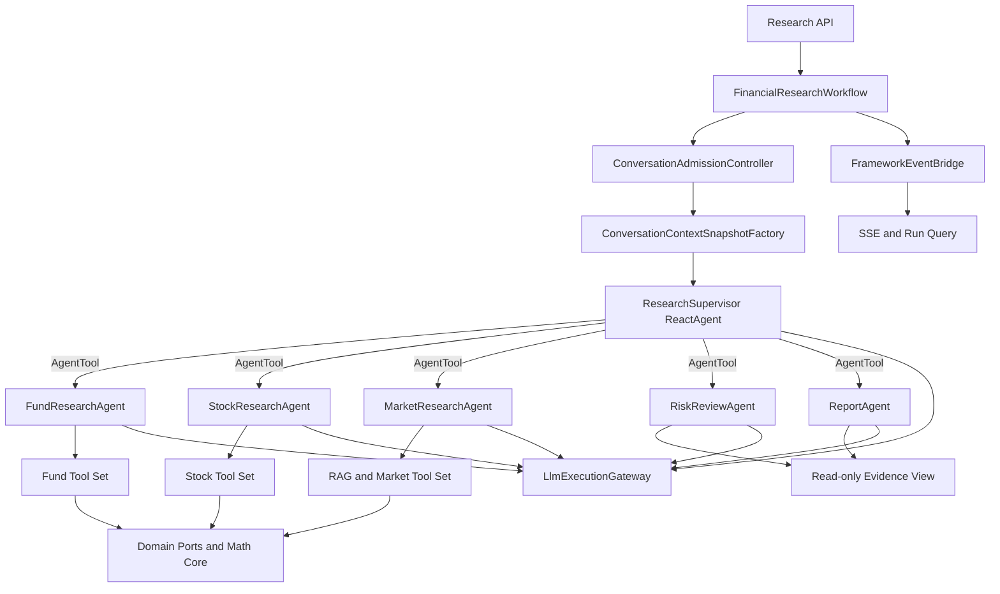

# Supervisor/Subagents 标准框架实验版设计

## 1. 背景与决策

当前平台使用自定义动态 DAG Runtime 负责编排，并由 AgentScope `ReActAgent` 执行规划节点和业务节点。这套实现能表达显式依赖，但平台同时承担了 Agent 循环、图状态、重规划、资源调度、检查点和事件协议，维护面较大。

本实验版在独立分支中验证另一条路线：使用标准开源 Agent Framework 直接实现 Supervisor/Subagents，由框架管理 Agent 循环、子 Agent 调用和图状态，平台只保留金融领域、身份隔离、容量治理、计费和 API 语义。

采用以下固定版本作为实验基线：

- Java 21
- Spring Boot 3.5.8
- Spring AI 1.1.2
- Spring AI Alibaba 1.1.2.2
- `spring-ai-alibaba-agent-framework`

Spring AI Alibaba 官方 Supervisor 模式使用一个 `ReactAgent` 作为 Supervisor，并通过 `AgentTool.getFunctionToolCallback(...)` 将专业 `ReactAgent` 暴露为工具。实验版遵循这一公开模式，不实现自制 Supervisor 循环。

## 2. 目标

实验版必须回答以下问题：

1. Supervisor 能否根据用户问题动态选择一个或多个金融专业 Agent。
2. 专业 Agent 能否继续复用现有确定性金融工具和领域端口。
3. 框架是否能替代自定义 Planner、Router、DAG Runtime、Replan 和 AgentScope 工厂。
4. 同步与 SSE 是否仍可共享 `FinancialResearchWorkflow.run(...)` 一个入口。
5. 用户、会话、Run、工具调用和事件是否能保持严格隔离。
6. 所有模型调用是否能经过统一限流、Token 计量和计费网关。
7. 框架状态与业务事实是否能清晰分离，避免把模型消息当作金融事实来源。

## 3. 非目标

第一版不实现：

- 跨服务 A2A Agent 发现。
- Supervisor 动态生成新的 Agent 类型。
- 任意 Agent 之间的自由群聊。
- Python LangGraph 服务。
- 多实例 Worker 租约和故障接管。
- 完整生产压测和自动扩缩容。
- 让模型自行计算收益率、回撤、Sharpe、Calmar 等指标。

多实例租约、Redis 广播和积分预冻结仍属于生产加固阶段；它们不应阻塞本次框架可行性验证。

## 4. 总体架构



架构边界为：

- Spring AI Alibaba 负责 `ReactAgent` 循环、Tool Calling、AgentTool 子 Agent 调用、Graph State 和框架事件。
- FinancialCopilot 负责认证身份、会话所有权、只读上下文快照、并发准入、模型容量、计费、金融工具、运行记录和外部 API。
- PostgreSQL保存业务状态和需要持久化的运行状态。
- Redis关闭时使用单实例内存协调；Redis开启时只做快速协调和事件广播。

## 5. 统一执行入口

外部仍只通过：

```java
ResearchRunHandle run(ResearchRunRequest request);
```

`ResearchRunRequest` 至少包含：

```java
record ResearchRunRequest(
    String workflowRunId,
    Long tenantId,
    Long userId,
    UUID conversationId,
    Long assistantMessageId,
    String prompt,
    boolean enableThinking,
    RunMode mode
) {}
```

控制器只从 Spring Security 读取一次登录身份。`tenantId`、`userId`、`conversationId`、`workflowRunId` 和 `assistantMessageId` 都由服务端产生或校验，不允许出现在模型可填写的工具参数中。

`ResearchRunHandle` 提供：

- `Flux<ResearchStreamEvent> events()`
- `CompletableFuture<ResearchRunResult> completion()`
- `cancel(String reason)`

同步 JSON 和 SSE 都订阅同一个 Handle，不建立第二条执行链路。

## 6. Supervisor 与 Subagents

### 6.1 ResearchSupervisor

`ResearchSupervisor` 是唯一直接面对用户问题的框架 `ReactAgent`。它负责：

- 判断请求涉及基金、股票、市场背景、风险复核或报告整理中的哪些能力。
- 将边界清晰的任务委派给专业 Agent。
- 在任务相互独立且框架支持时并行调用多个 AgentTool。
- 检查是否已有足够证据；证据不足时补充调用专业 Agent。
- 将多个专业结果合成为面向用户的最终回答。

Supervisor 不直接访问数据库，不直接调用底层金融数据端口，也不生成确定性金融指标。

### 6.2 专业 Agent 集合

第一版固定五个角色：

| Agent | 职责 | 允许的工具 |
|---|---|---|
| `FundResearchAgent` | 基金筛选、单基金分析、基金对比 | 基金筛选、量化分析、持仓、基金报告检索 |
| `StockResearchAgent` | 股票筛选、量化分析和对比 | 股票筛选、股票量化工具 |
| `MarketResearchAgent` | 指标定义、市场资料和公共知识检索 | Financial RAG、文档检索、公共市场记忆 |
| `RiskReviewAgent` | 检查证据完整性、冲突和风险披露 | 当前 Run 的只读 Evidence View |
| `ReportAgent` | 将已验证证据编辑成最终报告 | 当前 Run 的只读 Evidence View |

每个角色是启动时初始化的不可变 Spring Bean。角色描述、系统提示词、模型和 Toolkit 在初始化后不修改。调用级身份、问题和证据通过运行上下文传入。

### 6.3 子 Agent 调用协议

专业 Agent 通过框架 `AgentTool` 暴露给 Supervisor。模型只看见：

```text
task
expectedOutput
```

模型不可见且不可填写：

```text
tenantId
userId
conversationId
workflowRunId
agentRunId
sessionKey
assistantMessageId
```

平台使用 `ContextualAgentToolCallback` 包装官方 `AgentTool`，只负责从框架隐藏上下文中读取 `ResearchExecutionContext`、分配 `agentRunId`、记录事件和调用官方 AgentTool。该包装器不包含路由、规划或 ReAct 循环。

每次 Agent 调用生成独立 `agentRunId`；同一次用户请求共享 `workflowRunId`。

## 7. 工具设计

现有领域 Tool Bean 可以共享，但必须保持无调用级可变状态。框架适配层按角色组织：

```java
final class FundResearchTools {
    @Tool
    FundScreenResult screenFunds(FundScreenRequest request, ToolContext context);

    @Tool
    FundAnalysisResult analyzeFund(FundAnalysisRequest request, ToolContext context);
}
```

`ToolContext` 中的服务端字段不会进入模型 Tool Schema。适配层从其中取得 `ResearchExecutionContext`，再调用现有 `copilot-agent-tools` Bean。

约束如下：

- Toolkit 按 Agent 角色划分，不能构造一个全系统万能 Toolkit。
- Tool 参数只包含完成业务动作所需的数据。
- Tool 不从 ThreadLocal 获取身份。
- Tool 不接受模型提供的 `userId`、`sessionId`、`conversationId` 或 `runId`。
- Tool 返回结构化 DTO；模型不得替代 math-core 进行财务计算。
- 副作用工具默认不开放给本实验版 Agent。

## 8. 执行身份与上下文快照

每个 Run 创建一次不可变上下文：

```java
record ResearchExecutionContext(
    ExecutionIdentity identity,
    String workflowRunId,
    ConversationContextSnapshot conversation,
    Instant startedAt
) {}
```

```java
record ExecutionIdentity(
    Long tenantId,
    Long userId,
    UUID conversationId
) {}
```

`ConversationContextSnapshot` 由以下内容组成：

- 最近已完成的用户与助手消息。
- 用户投资画像。
- 当前用户问题。
- 允许访问的长期记忆摘要。

快照在 Run 启动后不再变化。同一个 Run 的 Supervisor 和所有 Subagent 共享该快照。Agent 中间消息、Tool Message 和推理过程不写回公共对话历史；只有最终用户消息、最终助手消息、脱敏 Tool Audit 和运行事件可以持久化。

## 9. 模型调用网关

所有框架 Agent 使用同一个受控 `ChatModel` 装饰器：

```text
ReactAgent
  -> GovernedChatModel
     -> LlmExecutionGateway
        -> 获取全局和用户许可
        -> 检查或预留额度
        -> 解析当前模型配置
        -> 调用真实 Spring AI ChatModel
        -> 记录 Token、延迟、模型和 agentRunId
        -> 原子结算
        -> 释放许可
```

Supervisor、所有 Subagent 以及报告合成都必须经过该 Bean。不能因为某个调用来自框架内部就绕过限流或计费。

实验版通过 `DelegatingChatModel` 读取当前 `LlmConfigManager` 配置，并缓存按配置指纹构建的真实 Spring AI `ChatModel`。配置改变时创建新 Delegate，正在执行的调用继续使用其启动时取得的 Delegate。

## 10. 状态、记忆和 Checkpoint

框架 Graph State 只保存完成编排所需的信息：

- 当前消息窗口。
- 已调用的 AgentTool。
- 专业 Agent 返回的结构化摘要。
- 框架的下一步状态。
- `workflowRunId` 引用。

它不作为对话、长期记忆、钱包或金融事实的最终来源。

第一版使用框架 `MemorySaver`，但每个 Run 使用独立 thread key：

```text
tenantId:userId:conversationId:workflowRunId
```

因此框架 Checkpoint 不会跨 Run 自动拼接消息。需要的历史由服务端生成的 `ConversationContextSnapshot` 显式传入。

后续生产阶段将 `MemorySaver` 替换为 PostgreSQL Checkpoint Saver。Redis关闭时不影响正确性；Redis开启时用于通知和 SSE 广播。

## 11. 并发和会话顺序

框架 Agent 编排不替代平台容量治理。`ConversationAdmissionController` 在调用 Supervisor 前执行：

- 同一 `conversationId` 最多一个活跃 Run。
- 同一用户默认最多两个活跃 Run。
- 系统设置最大活跃数和最大排队数。
- 用户自身并发或频率超限返回 `429`。
- 系统总容量已满返回 `503`。

不同用户和不同会话可以并发。Supervisor 是否并行调用独立 AgentTool 由配置 `parallelToolCalls` 控制，并受每 Run 最大 Agent 并发数限制。

身份和运行上下文必须通过框架 `RunnableConfig`、Graph State 或隐藏 `ToolContext` 显式传播。虚拟线程或 Reactor 切换线程不会影响身份，不使用 ThreadLocal。

### 11.1 多 Agent 一致性模型

Supervisor/Subagents 不共享可变业务对象。系统采用以下一致性规则：

1. **Supervisor 单写者**：只有 Supervisor Runtime 可以推进 Run 状态、确定任务阶段和发布最终回答。Subagent 不能直接修改 Run、Conversation 或其他 Agent 的结果。
2. **Subagent 追加式输出**：每个 Subagent 只能向自己的 `(workflowRunId, agentRunId)` 命名空间追加 `AgentEvidence` 和操作结果，不能覆盖已有 Evidence。
3. **服务端幂等键**：每次工具操作使用服务端生成的键：

   ```text
   workflowRunId:agentRole:toolName:canonicalInputHash
   ```

   模型不能提供或修改幂等键。相同 Run 内的重复工具调用返回第一次成功结果；失败结果是否重试由工具策略决定。
4. **版本化归并**：Supervisor 读取 Evidence Snapshot 时获得 `evidenceRevision`。提交归并结果时执行 Compare-And-Set；版本已变化则重新读取后归并，禁止用旧快照覆盖新证据。
5. **确定性冲突保留**：两个 Agent 对同一事实给出不同值时，Evidence Store 同时保留两条带来源和时间戳的证据，不采用最后写入覆盖。`RiskReviewAgent` 输出冲突说明，不能静默选择模型偏好的值。
6. **状态机约束**：Run 和 Agent Operation 只能进行合法状态迁移。终态不可退回运行态；取消后迟到的结果可以进入审计记录，但不能改变 Run 终态或最终报告。
7. **副作用集中执行**：第一版专业工具全部只读。未来支付、交易、消息发送等副作用必须经过独立 `CommandGateway`、数据库唯一键和 Outbox；Subagent 不得直接执行。
8. **有限重试**：只读、幂等操作可以自动重试。有副作用的未知结果不得盲目重试，必须先按幂等键查询操作状态。

### 11.2 Agent Operation Ledger

所有 Supervisor、Subagent 和 Tool 调用写入统一操作账本：

```java
record AgentOperation(
    String operationId,
    String idempotencyKey,
    String workflowRunId,
    String agentRunId,
    AgentRole role,
    String operationType,
    OperationStatus status,
    long expectedRevision,
    String resultReference,
    Instant startedAt,
    Instant completedAt
) {}
```

状态迁移限定为：

```text
REQUESTED -> RUNNING -> SUCCEEDED
                     -> FAILED
                     -> CANCELLED
```

`idempotencyKey` 建立唯一约束。两个并发调用竞争同一键时，只有一个获得执行权；另一个订阅已有操作结果。单实例阶段使用线程安全内存实现，生产持久化阶段使用 PostgreSQL 唯一索引和条件更新。

### 11.3 归并屏障

Supervisor 发起并行任务后创建预期 Agent Operation 集合。进入 Risk Review 和最终报告前必须满足归并屏障：

- 所有必需操作到达终态。
- 至少一个必需证据成功时才允许降级继续。
- 必需操作全部失败则 Run 失败。
- 可选操作超时会记录 warning，不无限等待。
- 取消信号优先于迟到结果。

归并顺序固定为 `role -> agentRunId -> evidenceId`，避免线程完成顺序改变最终输入顺序。

## 12. Evidence 与最终报告

每个专业 Agent 返回结构化 `AgentEvidence`：

```java
record AgentEvidence(
    String agentRunId,
    AgentRole role,
    EvidenceStatus status,
    List<EvidenceItem> items,
    List<String> warnings,
    String summary
) {}
```

`EvidenceItem` 必须包含来源、工具名、查询时间和结构化载荷引用。大体积原始载荷保存在 Run 隔离的 Artifact Store，消息中只传摘要和引用。

Supervisor 在最终回答前必须调用 `RiskReviewAgent`。报告较复杂时再调用 `ReportAgent`；简单单领域问题可以由 Supervisor 直接基于已复核证据回答。

## 13. 事件和 SSE

`FrameworkEventBridge` 把框架事件映射为稳定的平台事件：

```text
RUN_QUEUED
RUN_STARTED
SUPERVISOR_THINKING
SUBAGENT_STARTED
TOOL_STARTED
TOOL_COMPLETED
SUBAGENT_COMPLETED
RISK_REVIEW_COMPLETED
CONTENT_DELTA
RUN_COMPLETED
RUN_FAILED
RUN_CANCELLED
```

事件只包含可展示的决策摘要，不暴露完整 Chain of Thought。每个事件携带：

- eventId
- workflowRunId
- agentRunId（适用时）
- conversationId
- sequence
- timestamp
- sanitized payload

控制器不解析框架内部状态，只消费平台事件。

## 14. 错误处理

- Supervisor 无法选择 Agent：返回明确的能力不足错误，不回退到旧 Router。
- Subagent 失败：Supervisor 可在限定次数内改派或降级；超过限制后失败。
- 工具数据不足：返回 `INSUFFICIENT_EVIDENCE`，不能让模型补造数据。
- 模型限流：保持 Run 在有界队列中，超时后返回容量错误。
- 用户取消：传播到 Supervisor、正在运行的 Subagent 和工具。
- 会话不存在或不属于当前用户：统一返回 404。
- 旧 DAG Checkpoint：实验分支不读取、不迁移，也不兼容。

## 15. 删除与保留边界

实验分支完成硬切换后删除：

- `GraphPlannerAgent`
- `AgentNodeRouter`
- `AgentScopeAgentFactory`
- `DagRuntime` 及其 Planner、GraphPatch、ReadyQueue 和节点资源声明
- 只服务于上述 Runtime 的旧测试和配置

保留并适配：

- `FinancialResearchWorkflow` 门面
- `ConversationService` 和认证所有权检查
- `copilot-domain` 端口与策略
- `copilot-math-core`
- `copilot-agent-tools` 的确定性业务能力
- 钱包、计费、用户和支付模块
- 对外统一 Research Run API 和稳定事件 DTO

## 16. 配置

```yaml
copilot:
  supervisor:
    max-iterations: 12
    max-subagent-calls: 8
    parallel-tool-calls: true
    require-risk-review: true
  runtime:
    max-active-runs: 100
    max-queued-runs: 1000
    max-active-runs-per-user: 2
    max-agents-per-run: 3
    max-llm-concurrency: 16
    queue-timeout: 5m
  conversation:
    persistence-enabled: false
  redis:
    enabled: false
```

测试默认关闭 Redis 和对话持久化，但记忆隔离、运行事件和执行审计测试仍必须执行。

## 17. 测试策略

使用可编程的 `ChatModel` 测试，不依赖真实模型账户。

核心测试包括：

1. 基金问题只委派给 `FundResearchAgent`。
2. 混合问题委派给多个专业 Agent，并合并结果。
3. Supervisor 和 Subagent 都经过 `LlmExecutionGateway`。
4. 财务指标来自 Tool DTO，而不是模型文本计算。
5. LLM 无法向 Tool 注入用户身份或 Run 身份。
6. 用户 A 无法读取用户 B 的会话或 Evidence。
7. 相同 conversationId、不同 userId 的框架 thread key 不同。
8. 同一会话第二个 Run 被排队或返回冲突。
9. 不同会话可以并发。
10. 100 个并发 Run 的 Evidence 和事件不串线。
11. Subagent 失败、工具失败、取消和超时产生正确终态。
12. SSE 事件顺序稳定且不泄露 Chain of Thought。
13. 架构测试确认生产代码不再引用旧 DAG 和 AgentScope 类。
14. 两个 Agent 并发提交相同幂等键时只执行一次工具调用。
15. 旧 `evidenceRevision` 无法覆盖较新的 Evidence Snapshot。
16. 冲突事实被同时保留并交给 Risk Review，不使用最后写入覆盖。
17. Run 取消后的迟到 Subagent 结果不能改变终态或最终报告。
18. 并行 Agent 以不同完成顺序返回时，最终归并输入顺序保持一致。

## 18. 实施阶段

### 阶段 A：框架兼容性与最小闭环

- 升级 Spring Boot，并引入 Spring AI/Spring AI Alibaba BOM。
- 建立可编程 ChatModel 测试。
- 实现一个 Supervisor、基金 Agent 和市场 Agent。
- 证明 AgentTool 委派、隐藏 ToolContext 和事件映射可用。

阶段 A 如果无法证明调用级上下文可安全传播，则停止迁移，不继续删除旧实现。

### 阶段 B：完整角色和硬切换

- 增加股票、风险复核和报告 Agent。
- 接入现有金融 Tool。
- 将统一工作流入口切换到 Supervisor。
- 删除旧 Planner、Router、DAG Runtime 和 AgentScope 代码。

### 阶段 C：容量、隔离和计费

- 加入同会话串行、用户配额、全局模型许可和过载返回。
- 接入对话快照、长期记忆命名空间和模型计费网关。
- 完成并发隔离测试。

### 阶段 D：持久化和运行验证

- 使用 PostgreSQL Saver 替换 MemorySaver。
- 实现可重放事件和 SSE 续传。
- 完成真实模型冒烟测试、负载测试和与现有版本的质量对比。

## 19. 成功与退出条件

实验成功必须同时满足：

- 外部统一入口和用户隔离语义不退化。
- 旧自定义编排代码从生产路径删除。
- Supervisor 能稳定委派和合并至少两个专业 Agent。
- Tool Calling、取消、错误、事件和 Token 统计可以观测。
- 测试证明同会话顺序和跨用户隔离。
- 在代表性基金/股票问题集上，答案质量不低于当前实现，且平均模型调用次数和 Token 成本可解释。

如果框架无法安全传递调用级身份、事件无法稳定映射，或依赖升级导致现有平台不可接受的兼容性破坏，则保留实验分支结论，不合并到主线。
